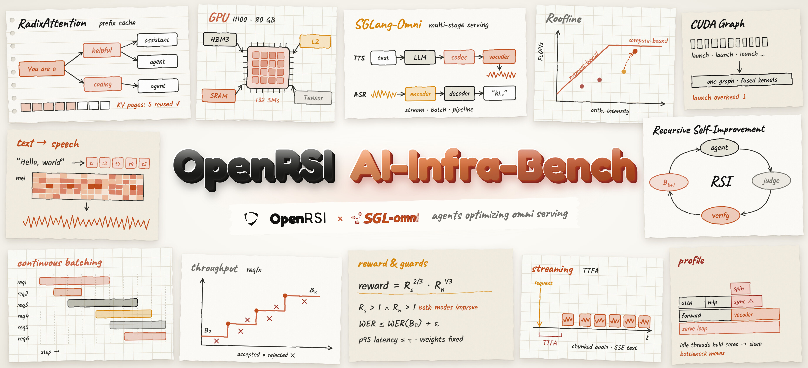
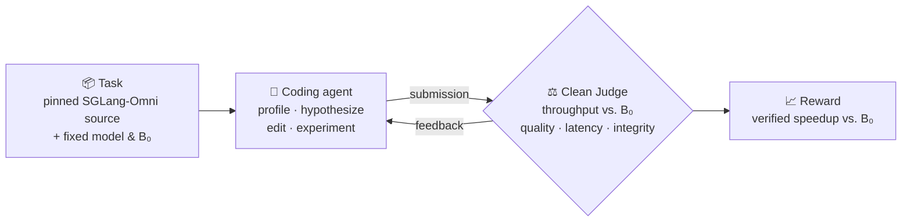

<p align="center">
  
</p>

<h3 align="center">Can coding agents make real AI infrastructure faster?</h3>

<p align="center">
  <a href="https://index.openrsi.foundation/blog/2026/openrsi-sglang-omni/">Blog</a> ·
  <a href="https://index.openrsi.foundation">OpenRSI Index</a> ·
  <a href="#-leaderboard">Leaderboard</a> ·
  <a href="#-tasks">Tasks</a> ·
  <a href="#-quick-start">Quick Start</a> ·
  <a href="#-evaluation">Evaluation</a> ·
  <a href="https://huggingface.co/datasets/OpenRSI-Foundation/OpenRSI-Index-Logs/tree/main/sglang-omni">Trajectories</a> ·
  <a href="https://github.com/OpenRSI-Foundation/OpenRSI-Index/tree/main/RSI-Harness">RSI-Harness</a> ·
  <a href="https://github.com/sgl-project/sglang-omni">SGLang-Omni</a>
</p>

<p align="center">
  <a href="https://index.openrsi.foundation/blog/2026/openrsi-sglang-omni/"></a>
  <a href="#-tasks"></a>
  <a href="#-leaderboard"></a>
  <a href="#-from-benchmark-to-upstream"></a>
  <a href="LICENSE"></a>
</p>

**OpenRSI-AI-Infra-Bench** benchmarks **recursive self-improvement (RSI) in real AI serving systems**. Agents iteratively optimize a serving stack with fixed model weights and GPU resources. An independent clean-image evaluator verifies speedups under **quality, tail-latency, and streaming-continuity constraints** against the initial baseline $B_0$.

Developed [jointly by OpenRSI and the SGLang-Omni team](https://index.openrsi.foundation/blog/2026/openrsi-sglang-omni/), the benchmark includes **12 natively `rsi-harness`-runnable tasks across 10 omni model configurations** (9 TTS and 3 ASR/diarization tasks). Each task provides a self-contained production serving stack with pinned source code, SHA-256-verified weights and evaluation splits, pre-calibrated reference $B_0$ metrics, and anti-cheat-hardened evaluation gates. This repository is mounted directly at `rsi-tasks/sglang-omni` in [OpenRSI-Index](https://github.com/OpenRSI-Foundation/OpenRSI-Index).

## 🏆 Leaderboard

Two coding agents, evaluated under single-agent [RSI-Harness](https://github.com/OpenRSI-Foundation/OpenRSI-Index/tree/main/RSI-Harness) runs:

| Agent | Model | Reasoning effort |
| :--- | :--- | :---: |
| **Codex** | `gpt-6-astra` | `xhigh` |
| **Claude Code** | `claude-opus-5-5` | `max` |

Below is the **best verified reward per task and agent** across the **21 published unguided single-agent Main trajectories** in [OpenRSI-Index-Logs](https://huggingface.co/datasets/OpenRSI-Foundation/OpenRSI-Index-Logs/tree/main/sglang-omni). **Higher is better; 1.0× is the starting baseline $B_0$.**

| Task | Modality | Mode | Codex | Claude Code | Trajectories |
| :--- | :---: | :--- | ---: | ---: | :--- |
| [`cosyvoice3-dual-mode`](tasks/cosyvoice3-dual-mode/) | TTS | Dual mode | 1.172× | **1.297×** | [Logs](https://huggingface.co/datasets/OpenRSI-Foundation/OpenRSI-Index-Logs/tree/main/sglang-omni/cosyvoice3-dual-mode) |
| [`moss-tts-v1.5-dual-mode`](tasks/moss-tts-v1.5-dual-mode/) | TTS | Dual mode | 1.339× | **1.935×** | [Logs](https://huggingface.co/datasets/OpenRSI-Foundation/OpenRSI-Index-Logs/tree/main/sglang-omni/moss-tts-v1.5-dual-mode) |
| [`fish-s2-pro-dual-mode`](tasks/fish-s2-pro-dual-mode/) | TTS | Dual mode | 1.803× | **6.288×** | [Logs](https://huggingface.co/datasets/OpenRSI-Foundation/OpenRSI-Index-Logs/tree/main/sglang-omni/fish-s2-pro-dual-mode) |
| [`qwen3-tts-0.6b-dual-mode`](tasks/qwen3-tts-0.6b-dual-mode/) | TTS | Dual mode | 1.141× | **1.252×** | [Logs](https://huggingface.co/datasets/OpenRSI-Foundation/OpenRSI-Index-Logs/tree/main/sglang-omni/qwen3-tts-0.6b-dual-mode) |
| [`qwen3-tts-1.7b-dual-mode`](tasks/qwen3-tts-1.7b-dual-mode/) | TTS | Dual mode | 1.096× | **1.283×** | [Logs](https://huggingface.co/datasets/OpenRSI-Foundation/OpenRSI-Index-Logs/tree/main/sglang-omni/qwen3-tts-1.7b-dual-mode) |
| [`ming3-tts-0.5b-nonstream`](tasks/ming3-tts-0.5b-nonstream/) | TTS | Non-streaming | — | **4.298×**† | [Logs](https://huggingface.co/datasets/OpenRSI-Foundation/OpenRSI-Index-Logs/tree/main/sglang-omni/ming3-tts-0.5b-nonstream) |
| [`ming3-tts-0.5b-streaming`](tasks/ming3-tts-0.5b-streaming/) | TTS | Streaming | **2.038×** | — | [Logs](https://huggingface.co/datasets/OpenRSI-Foundation/OpenRSI-Index-Logs/tree/main/sglang-omni/ming3-tts-0.5b-streaming) |
| [`ming3-tts-tiny-nonstream`](tasks/ming3-tts-tiny-nonstream/) | TTS | Non-streaming | 1.899׆ | **3.634×** | [Logs](https://huggingface.co/datasets/OpenRSI-Foundation/OpenRSI-Index-Logs/tree/main/sglang-omni/ming3-tts-tiny-nonstream) |
| [`ming3-tts-tiny-streaming`](tasks/ming3-tts-tiny-streaming/) | TTS | Streaming | **1.722×** | — | [Logs](https://huggingface.co/datasets/OpenRSI-Foundation/OpenRSI-Index-Logs/tree/main/sglang-omni/ming3-tts-tiny-streaming) |
| [`qwen3-asr-1.7b-dual-mode`](tasks/qwen3-asr-1.7b-dual-mode/) | ASR | Dual mode | 1.117× | **1.317×**† | [Logs](https://huggingface.co/datasets/OpenRSI-Foundation/OpenRSI-Index-Logs/tree/main/sglang-omni/qwen3-asr-1.7b-dual-mode) |
| [`whisper-large-v3-dual-mode`](tasks/whisper-large-v3-dual-mode/) | ASR | Dual mode | 1.126× | **1.979×**† | [Logs](https://huggingface.co/datasets/OpenRSI-Foundation/OpenRSI-Index-Logs/tree/main/sglang-omni/whisper-large-v3-dual-mode) |
| [`moss-transcribe-diarize-dual-mode`](tasks/moss-transcribe-diarize-dual-mode/) | ASR | Dual mode | 1.134× | **1.490×** | [Logs](https://huggingface.co/datasets/OpenRSI-Foundation/OpenRSI-Index-Logs/tree/main/sglang-omni/moss-transcribe-diarize-dual-mode) |

<sub>
† The run ended as <code>failed</code> or <code>cancelled</code> after ~12–24 h, retaining its best completed Judge score from an earlier round.<br>
Preparation/calibration runs, guided ablations, and multi-agent framework runs are excluded so every score reflects unguided single-agent optimization.
</sub>

<details>
<summary><strong>Hardware, budgets and provenance notes</strong></summary>

- All dual-mode tasks used one **H100 80GB HBM3** and ~24 hours of runtime.
- Ming3 non-streaming runs used **H100 NVL** / **H200**; Ming3 streaming runs used **H200**.
- `cosyvoice3-dual-mode` ships at the exact unguided SGLang-Omni `1523543056bf` commit measured by both Main baselines (`1.172×` and `1.297×`).
- All 12 packages standardize on a 24-hour (`86400s`) agent budget in `task.toml` and ship pre-calibrated reference $B_0$ metrics in `tests/baseline.json` (with optional `RSI_BASELINE_JSON` override for non-reference GPU SKUs).

</details>

📊 [Run records and methodology](results/README.md) ·
🗂️ [Machine-readable snapshot](results/main.json) ·
📋 [Published runs CSV](results/runs.csv) ·
🔍 [Interactive RSI Logs Viewer](https://index.openrsi.foundation/logs/)

## 📰 News

- **2026.11** — 🚀 **OpenRSI-AI-Infra-Bench released**: 12 native Harbor 1.4 SGLang-Omni benchmarks with 21 sanitized Codex and Claude Code trajectories.
- **2026.11** — 📝 Blog: **[OpenRSI × SGLang-Omni: Scaling RSI for AI Infra](https://index.openrsi.foundation/blog/2026/openrsi-sglang-omni/)**.
  Agent-found optimizations raised throughput by **+7.6% to +326.5%** on H100 across eight omni model families; **14 PRs** were reviewed and merged by SGLang-Omni maintainers.

## ✨ Highlights

<table>
  <tr>
    <td align="center" width="20%"><h3>10</h3></td>
    <td align="center" width="20%"><h3>12</h3></td>
    <td align="center" width="20%"><h3>6.29×</h3></td>
    <td align="center" width="20%"><h3>14</h3></td>
    <td align="center" width="20%"><h3>1 GPU</h3></td>
  </tr>
  <tr>
    <td align="center">Omni models</td>
    <td align="center">Tasks</td>
    <td align="center">Best reward</td>
    <td align="center">Merged PRs</td>
    <td align="center">Per task</td>
  </tr>
</table>

- **Production tasks, validated by real PRs.** Jointly designed and reviewed by OpenRSI and SGLang-Omni.
- **100% native `rsi-harness run` out of the box.** One GPU + 16 auto-discovered NUMA-local physical CPU cores per task, clean-image Judge isolation, and `--agent oracle` verification (`reward = 1.0`).

## ⚙️ How it works



RSI-Harness runs the outer loop: the agent works inside an isolated container, submits candidates, and receives structured Judge verdicts. Every submission is evaluated from scratch in a clean Judge container against the fixed reference baseline $B_0$.

Each task package contains:

```text
tasks/<task-slug>/
├── instruction.md      # objective, allowed changes and constraints
├── task.toml           # Harbor 1.4 resources, timeouts, clean-image Judge config
├── README.md           # reference B0 metrics, logged scores and recalibration guide
├── environment/        # Dockerfile, lockfiles and SGLang-Omni source archive
├── solution/solve.sh   # restores starting implementation (--agent oracle -> 1.0)
└── tests/              # clean-image evaluator, baseline.json, quality & anti-cheat gates
```

## 📦 Tasks

The collection contains **12 tasks**: eight dual-mode tasks (5 TTS + 3 ASR) and four Ming3-TTS single-mode tasks (non-streaming and streaming for 0.5B and Tiny).

| Model | Track | Evaluation modes | Reference $B_0$ GPU | Package |
| :--- | :---: | :--- | :--- | :--- |
| **CosyVoice3 (0.5B)** | 🗣️ TTS | Dual mode | H100 80GB HBM3 | [`tasks/cosyvoice3-dual-mode`](tasks/cosyvoice3-dual-mode/) |
| **MOSS-TTS v1.5** | 🗣️ TTS | Dual mode | H100 80GB HBM3 | [`tasks/moss-tts-v1.5-dual-mode`](tasks/moss-tts-v1.5-dual-mode/) |
| **Fish Audio S2-Pro** | 🗣️ TTS | Dual mode | H100 80GB HBM3 | [`tasks/fish-s2-pro-dual-mode`](tasks/fish-s2-pro-dual-mode/) |
| **Qwen3-TTS Base 0.6B** | 🗣️ TTS | Dual mode | H100 80GB HBM3 | [`tasks/qwen3-tts-0.6b-dual-mode`](tasks/qwen3-tts-0.6b-dual-mode/) |
| **Qwen3-TTS Base 1.7B** | 🗣️ TTS | Dual mode | H100 80GB HBM3 | [`tasks/qwen3-tts-1.7b-dual-mode`](tasks/qwen3-tts-1.7b-dual-mode/) |
| **Ming3-TTS 0.5B** | 🗣️ TTS | Non-streaming | H100 NVL | [`tasks/ming3-tts-0.5b-nonstream`](tasks/ming3-tts-0.5b-nonstream/) |
| **Ming3-TTS 0.5B** | 🗣️ TTS | Streaming | H200 | [`tasks/ming3-tts-0.5b-streaming`](tasks/ming3-tts-0.5b-streaming/) |
| **Ming3-TTS Tiny** | 🗣️ TTS | Non-streaming | H100 NVL | [`tasks/ming3-tts-tiny-nonstream`](tasks/ming3-tts-tiny-nonstream/) |
| **Ming3-TTS Tiny** | 🗣️ TTS | Streaming | H200 | [`tasks/ming3-tts-tiny-streaming`](tasks/ming3-tts-tiny-streaming/) |
| **Qwen3-ASR 1.7B** | 👂 ASR | Dual mode | H100 80GB HBM3 | [`tasks/qwen3-asr-1.7b-dual-mode`](tasks/qwen3-asr-1.7b-dual-mode/) |
| **Whisper large-v3** | 👂 ASR | Dual mode | H100 80GB HBM3 | [`tasks/whisper-large-v3-dual-mode`](tasks/whisper-large-v3-dual-mode/) |
| **MOSS-Transcribe-Diarize** | 👂 ASR | Dual mode | H100 80GB HBM3 | [`tasks/moss-transcribe-diarize-dual-mode`](tasks/moss-transcribe-diarize-dual-mode/) |

> [!NOTE]
> For TTS, *streaming* means incremental multi-chunk PCM audio delivery (`>= 95%` multi-chunk responses and `c50 >= 95%`). For ASR, it means incremental SSE text deltas (`single_delta_fraction <= 5%`) after audio upload.

## 🔁 From benchmark to upstream

The same harnessed loop was used to land real optimizations in SGLang-Omni.
Agents did the performance work; people defined the problems and reviewed the PRs.
Throughput gains on **H100** (non-streaming / streaming), measured on
`sglang-omni` main before the first and after the last OpenRSI PR:

| Model | Merged PRs | Non-streaming | Streaming |
| :--- | :--- | ---: | ---: |
| CosyVoice3 | [#2524](https://github.com/sgl-project/sglang-omni/pull/2524) [#2555](https://github.com/sgl-project/sglang-omni/pull/2555) | +44.4% | +46.2% |
| MOSS-TTS | [#2525](https://github.com/sgl-project/sglang-omni/pull/2525) [#2859](https://github.com/sgl-project/sglang-omni/pull/2859) | +48.5% | +76.3% |
| Fish S2-Pro | [#2778](https://github.com/sgl-project/sglang-omni/pull/2778) | +9.6% | +0.3% |
| Qwen3-TTS | [#2779](https://github.com/sgl-project/sglang-omni/pull/2779) | +25.2% | +4.7% |
| Qwen3-ASR | [#2880](https://github.com/sgl-project/sglang-omni/pull/2880) [#2881](https://github.com/sgl-project/sglang-omni/pull/2881) [#2882](https://github.com/sgl-project/sglang-omni/pull/2882) | +14.2% | +5.0% |
| Whisper large-v3 | [#2901](https://github.com/sgl-project/sglang-omni/pull/2901) | +7.6% | +12.2% |
| MOSS-Transcribe-Diarize | [#3071](https://github.com/sgl-project/sglang-omni/pull/3071) | +18.8% | +30.0% |
| Ming3-TTS 0.5B | [#3136](https://github.com/sgl-project/sglang-omni/pull/3136) [#3189](https://github.com/sgl-project/sglang-omni/pull/3189) [#3190](https://github.com/sgl-project/sglang-omni/pull/3190) | **+326.5%** | **+93.9%** |

<sub>These upstream numbers come from a separate measurement protocol than the benchmark
rewards above, and some ranges include non-OpenRSI changes. See the
<a href="https://index.openrsi.foundation/blog/2026/openrsi-sglang-omni/">blog post</a>
for H200 results, per-PR caveats and the five recurring optimization patterns
(idle-thread spinning, per-hop data conversion, unused work, small GPU launches, and
unpipelined prefill/decode).</sub>

## 🚀 Quick start

### 1. Clone and verify task integrity

```bash
git clone https://github.com/OpenRSI-Foundation/OpenRSI-AI-Infra-Bench.git
cd OpenRSI-AI-Infra-Bench

# Verify all 12 task manifests, hashes, and syntax (CPU-only, no GPU needed)
python3 -B scripts/verify.py
```

### 2. Install RSI-Harness and run `--agent oracle`

**Requirements:** Linux, Docker Engine 26+, NVIDIA Container Toolkit, Python 3.12, 1 GPU (80 GB+ VRAM recommended), 16 idle physical CPU cores, 128 GiB RAM, and ~200 GiB disk space.

Install [RSI-Harness](https://github.com/OpenRSI-Foundation/OpenRSI-Index/tree/main/RSI-Harness) from `OpenRSI-Index`, then sanity-check any TTS or ASR task with `--agent oracle` (builds images, runs all 3-repetition evaluation passes, and verifies `reward = 1.0`):

```bash
rsi-harness run tasks/cosyvoice3-dual-mode --agent oracle --gpus 0
rsi-harness run tasks/qwen3-asr-1.7b-dual-mode --agent oracle --gpus 0
```

### 3. Launch a coding agent

All 12 TTS and ASR tasks use the exact same `rsi-harness run` entrypoint:

```bash
TASK_DIR="$PWD/tasks/cosyvoice3-dual-mode"

# Codex
rsi-harness run "$TASK_DIR" \
  --agent codex --model gpt-6-astra --reasoning-effort xhigh \
  --agent-auth local --gpus 0

# Claude Code
rsi-harness run "$TASK_DIR" \
  --agent claude-code --model claude-opus-5-5 --reasoning-effort max \
  --agent-auth local --gpus 0
```

> [!TIP]
> **Custom GPU SKUs (`RSI_BASELINE_JSON`):** Each task ships pre-calibrated reference $B_0$ metrics in `tests/baseline.json` (H100 SXM5 / H100 NVL / H200). When running optimization loops on a different GPU SKU, measure a fresh 3-repetition $B_0$ once with `/opt/sglang/bin/python3 -I -B /tests/calibrate.py` and pass `RSI_BASELINE_JSON`—see [docs/running.md](docs/running.md).

### 4. Inspect the results

```bash
rsi-harness visualize   # then open http://127.0.0.1:8000
```

📖 **[Full setup, GPU calibration and execution guide →](docs/running.md)**

## ⚖️ Evaluation

The target is **serving throughput**, subject to the task's quality, latency,
resource and integrity checks. A faster implementation is ineligible (`reward = 0.0` / rejected) if it fails any guard.

For dual-mode tasks (both TTS and ASR), let $R_s$ and $R_n$ be the streaming and non-streaming throughput ratios against the reference baseline $B_0$:

$$
\mathrm{reward} = R_s^{2/3} \, R_n^{1/3}.
$$

**Both modes must strictly improve** over $B_0$ (`> 1.0`) for modified candidates, so a gain in one mode cannot mask a regression in the other. Ming3's single-mode tasks score the target mode's throughput ratio against $B_0$.

| | Workload and checks |
| :--- | :--- |
| **TTS** | 1,088 English SeedTTS requests per repetition; concurrency 16; 3 repetitions per mode; independent `Qwen3-ASR-1.7B` WER verification (`<= 0.02`), `3%` latency/RTF/TTFA P95 budgets, and `>= 95%` multi-chunk streaming continuity |
| **ASR** | English and Chinese SeedTTS splits; non-streaming HTTP and post-upload SSE; 3 repetitions per language and mode; strict WER/CER ceilings, `single_delta_fraction <= 5%`, and speaker-turn diarization check (`>= 80%` on MOSS-TD) |
| **System guards** | Automatic NUMA-local 16-physical-core pinning, host contention gate (`peak_foreign_cores <= 2`), frozen weights & sampling semantics, AST & call-site liveness verification, and `0 MiB` GPU process cleanup |

## 🔗 Resources

| Resource | Link |
| :--- | :--- |
| Blog post | [OpenRSI × SGLang-Omni: Scaling RSI for AI Infra](https://index.openrsi.foundation/blog/2026/openrsi-sglang-omni/) |
| OpenRSI Index | [index.openrsi.foundation](https://index.openrsi.foundation) · [GitHub](https://github.com/OpenRSI-Foundation/OpenRSI-Index) (`rsi-tasks/sglang-omni`) |
| Trajectories | [OpenRSI-Index-Logs (`sglang-omni/`)](https://huggingface.co/datasets/OpenRSI-Foundation/OpenRSI-Index-Logs/tree/main/sglang-omni) · [Logs Viewer](https://index.openrsi.foundation/logs/) |
| Runner | [RSI-Harness](https://github.com/OpenRSI-Foundation/OpenRSI-Index/tree/main/RSI-Harness) |
| Serving framework | [SGLang-Omni](https://github.com/sgl-project/sglang-omni) |
| Task collection | [Browse tasks](tasks/) |
| Contribute a task | [Call for contributors](https://github.com/OpenRSI-Foundation/OpenRSI-Index#-call-for-contributors) |

## 📜 Provenance and license

The benchmark tasks originate from OpenRSI Index discussions [#154](https://github.com/OpenRSI-Foundation/OpenRSI-Index/discussions/154) (TTS) and [#257](https://github.com/OpenRSI-Foundation/OpenRSI-Index/discussions/257) (ASR). All 21 single-agent baseline trajectories are archived in uncompressed form in [OpenRSI-Index-Logs](https://huggingface.co/datasets/OpenRSI-Foundation/OpenRSI-Index-Logs/tree/main/sglang-omni).

This repository carries the [Apache-2.0 license](LICENSE). Bundled source, model weights and datasets retain their own upstream licenses and attribution requirements.

## 📖 Citation

If you use OpenRSI-AI-Infra-Bench, please cite:

```bibtex
@misc{li2026openrsisglangomni,
  title  = {{OpenRSI $\times$ SGLang-Omni: Scaling RSI for AI Infra}},
  author = {Li, Zhuofeng and Tian, Aaron and Feng, Yichen and Chai, Wenhao and
            Han, Xinyang and Li, Cara and Liang, Shujia and Li, Yuetai and
            Zhao, Chenyang},
  year   = {2026},
  month  = nov,
  url    = {https://index.openrsi.foundation/blog/2026/openrsi-sglang-omni/}
}
```

---

<p align="center">
  Built by the <a href="https://github.com/OpenRSI-Foundation"><b>OpenRSI Foundation</b></a>
  with the <a href="https://github.com/sgl-project/sglang-omni"><b>SGLang-Omni</b></a> community.
</p>
