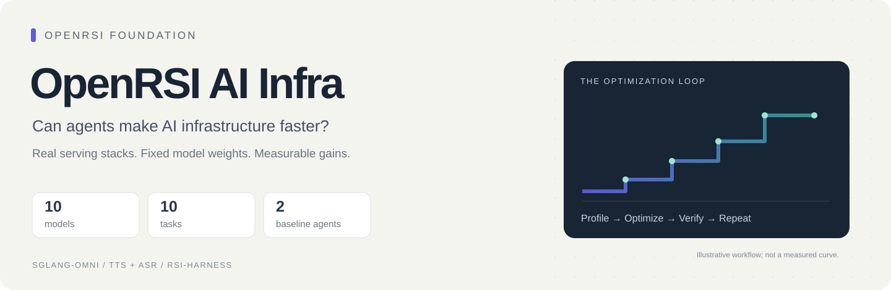
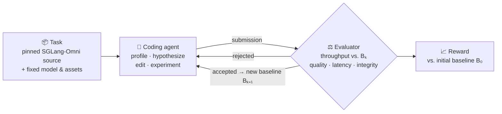

<p align="center">
  
</p>

<h3 align="center">Can coding agents make real AI infrastructure faster?</h3>

<p align="center">
  <a href="https://index.openrsi.foundation/blog/2026/openrsi-sglang-omni/">Blog</a> ·
  <a href="https://index.openrsi.foundation">OpenRSI Index</a> ·
  <a href="#-tasks">Tasks</a> ·
  <a href="#-baselines">Baselines</a> ·
  <a href="#-quick-start">Quick Start</a> ·
  <a href="#-evaluation">Evaluation</a> ·
  <a href="https://github.com/OpenRSI-Foundation/OpenRSI-Index/tree/main/RSI-Harness">RSI-Harness</a> ·
  <a href="https://github.com/sgl-project/sglang-omni">SGLang-Omni</a>
</p>

<p align="center">
  <a href="https://index.openrsi.foundation/blog/2026/openrsi-sglang-omni/"></a>
  <a href="#-tasks"></a>
  <a href="#-baselines"></a>
  <a href="#-from-benchmark-to-upstream"></a>
  <a href="LICENSE"></a>
</p>

**OpenRSI-AI-Infra-bench** benchmarks **recursive self-improvement (RSI) in real AI serving systems**. Agents iteratively optimize a serving stack with fixed model weights and GPU resources. An independent evaluator verifies speedups under **quality and latency constraints**, and each accepted improvement becomes the baseline for the next round.

Developed [jointly by OpenRSI and the SGLang-Omni team](https://index.openrsi.foundation/blog/2026/openrsi-sglang-omni/), the collection includes **10 carefully reviewed tasks for omni models**, with pinned source code, assets, dependencies and evaluation protocols. It is part of the [OpenRSI Index](https://index.openrsi.foundation/), starting with agents that improve the infrastructure AI runs on.

## 📰 News

- **2026.11** — 🚀 **OpenRSI AI Infra released**: 10 SGLang-Omni tasks with
  Codex and Claude Code baselines.
- **2026.11** — 📝 Blog: **[OpenRSI × SGLang-Omni: Scaling RSI for AI Infra](https://index.openrsi.foundation/blog/2026/openrsi-sglang-omni/)**.
  Agent-found optimizations raised throughput by **+7.6% to +326.5%** on H100 across
  eight omni models; **14 PRs** were reviewed and merged by SGLang-Omni maintainers.

## ✨ Highlights

- **Production tasks, validated through real PRs.** Every task targets a bottleneck
  in SGLang-Omni's production serving stack. The OpenRSI and SGLang-Omni teams
  repeatedly refine its objective, evaluator and constraints, using real
  optimization PRs to check that the task captures meaningful engineering work.
- **One GPU per task.** The full optimization and evaluation loop runs on a
  single compatible GPU, making individual tasks straightforward to run and
  reproduce.

## ⚙️ How it works



RSI-Harness runs the outer loop: the agent works inside a container, submits
candidates, and receives only evaluator verdicts. Calibration state (the initial
baseline $B_0$ and A/A noise checks) stays outside the agent's workspace.

Each task package contains:

```text
tasks/<model>/<task-name>/
├── instruction.md      # objective, allowed changes and constraints
├── task.toml           # resources, time limits, runtime configuration
├── environment/        # container build, pinned runtime, model asset specs
├── tests/              # evaluator, fixed assets, quality checks, scoring rules
├── solution/solve.sh   # restores the starting implementation
└── publication.json    # original source revision and file hashes
```

## 📦 Tasks

The collection contains **10 tasks, one per model**. Eight evaluate streaming
and non-streaming together; Ming3 0.5B and Tiny each provide separate packages
for the two modes, yielding 12 runnable packages in total.

| Model | Track | Evaluation modes | Agent budget | Package |
| :--- | :---: | :--- | :---: | :--- |
| **CosyVoice3** | 🗣️ TTS | Dual mode | 24 h | [Task](tasks/cosyvoice3/sglang-omni-cosyvoice3-dual-mode-runtime/) |
| **MOSS-TTS v1.5** | 🗣️ TTS | Dual mode | 24 h | [Task](tasks/moss-tts-v1.5/sglang-omni-moss-v1.5-dual-mode-runtime/) |
| **Fish S2-Pro** | 🗣️ TTS | Dual mode | 24 h | [Task](tasks/fish-s2-pro/sglang-omni-fish-s2-pro-dual-mode-runtime/) |
| **Qwen3-TTS Base 0.6B** | 🗣️ TTS | Dual mode | 24 h | [Task](tasks/qwen3-tts-0.6b/sglang-omni-qwen3-tts-base-0.6b-dual-mode-runtime/) |
| **Qwen3-TTS Base 1.7B** | 🗣️ TTS | Dual mode | 24 h | [Task](tasks/qwen3-tts-1.7b/sglang-omni-qwen3-tts-base-1.7b-dual-mode-runtime/) |
| **Ming3-TTS 0.5B** | 🗣️ TTS | Separate NS / S | 24 h / 8 h | [Non-streaming](tasks/ming3-0.5b/sglang-omni-ming3-0.5b-nonstream/) · [Streaming](tasks/ming3-0.5b/sglang-omni-ming3-0.5b-streaming/) |
| **Ming3-TTS Tiny** | 🗣️ TTS | Separate NS / S | 24 h / 8 h | [Non-streaming](tasks/ming3-tiny/sglang-omni-ming3-tiny-nonstream/) · [Streaming](tasks/ming3-tiny/sglang-omni-ming3-tiny-streaming/) |
| **Qwen3-ASR 1.7B** | 👂 ASR | Dual mode | 24 h | [Task](tasks/qwen3-asr-1.7b/qwen3-asr-streaming-throughput/) |
| **Whisper large-v3** | 👂 ASR | Dual mode | 24 h | [Task](tasks/whisper-large-v3/whisper-asr-streaming-throughput/) |
| **MOSS-Transcribe-Diarize** | 👂 ASR | Dual mode | 24 h | [Task](tasks/moss-transcribe-diarize/moss-transcribe-diarize-streaming-throughput/) |

> [!NOTE]
> For TTS, *streaming* means incremental audio delivery. For ASR, it means text
> delivered over SSE after the audio upload, not live microphone streaming. The
> Ming3 streaming packages use a different source baseline and compatibility port
> from their non-streaming counterparts.

## 🏆 Baselines

Two coding agents, run under RSI-Harness:

| Agent | Model | Reasoning effort |
| :--- | :--- | :---: |
| **Codex** | `gpt-6-astra` | `xhigh` |
| **Claude Code** | `claude-opus-5-5` | `max` |

Below is the **best recorded reward per task and agent** among archived Main
research runs. Each score was checked against the completed evaluator report of
its best submission. **Higher is better; 1.0× is the starting performance.**
These are historical results, not new evaluations of this repository snapshot.

| Task | Scored modes | Codex | Claude Code | Runs¹ |
| :--- | :--- | ---: | ---: | :---: |
| CosyVoice3 | Dual | 1.172× | **1.297×** | 1 / 1 |
| MOSS-TTS v1.5 | Dual | 1.440× | **2.195×** | 2 / 2 |
| Fish S2-Pro | Dual | 1.803× | **6.288×** | 2 / 1 |
| Qwen3-TTS Base 0.6B | Dual | 1.141× | **1.252×** | 1 / 2 |
| Qwen3-TTS Base 1.7B | Dual | 1.096× | **1.283×** | 2 / 1 |
| Ming3-TTS 0.5B | Non-streaming | n/a‡ | **4.298×**† | — / 2 |
| Ming3-TTS Tiny | Non-streaming | 1.899׆ | **3.634×** | 2 / 1 |
| Qwen3-ASR 1.7B | Dual | 1.139× | **1.317×**† | 2 / 1 |
| Whisper large-v3 | Dual | 1.126× | **1.979×**† | 1 / 1 |
| MOSS-Transcribe-Diarize | Dual | 1.134× | **1.490×** | 1 / 1 |

<sub>
¹ Run counts are <b>Codex / Claude Code</b>, including interrupted and unscored
research runs. Preparation runs, model-scaling experiments and other agent frameworks
are excluded. The table is a best-observed summary, not a mean over seeds.<br>
† The overall run ended as <code>failed</code> or <code>cancelled</code>, but kept the
shown score from an earlier completed submission.<br>
‡ The Main tracking sheet marks the Ming3-0.5B Codex run as done, but its numerical
result was not found in the inspected archive, so no score is assigned.
</sub>

<details>
<summary><strong>Hardware, budgets and version notes</strong></summary>

- Most selected runs used one **H100 80GB HBM3** and a **24-hour** budget.
- Ming3 Tiny used **H200 / 24 h** for Codex and **H100 NVL / 12 h** for Claude Code.
  Its Codex run failed after about 14.9 h. Ming3-0.5B Claude Code used H100 NVL with
  a 24 h budget and was cancelled after about 12.2 h.
- Qwen3-ASR and Whisper Claude Code runs had 48 h configured budgets and were
  cancelled after about 24.4 h and 24.0 h, respectively. Runtime can include
  evaluator overhead beyond an agent's configured limit.
- **CosyVoice3 differs by version:** Main baselines use SGLang-Omni
  `1523543056bf` (0.1.7); the task copied from SGNOMI is the later guided version at
  `fa90213e1674` (0.1.9). Its Main scores do not measure that later task.
- Ming3 scores above are **non-streaming only**. The two streaming task packages
  are included in the benchmark but have no scores in this Main selection.
- Hardware, time budgets and the number of attempts vary. We therefore do not
  report an aggregate ranking or a controlled agent-to-agent win rate.

</details>

📊 [Run records and methodology](results/README.md) ·
🗂️ [Machine-readable snapshot](results/main.json) ·
📋 [All qualifying runs](results/runs.csv) ·
Public dashboard: *coming soon*

<!-- TODO: Replace the dashboard placeholder with the public Main-results URL. -->

## 🔁 From benchmark to upstream

The same harnessed loop was used to land real optimizations in SGLang-Omni.
Agents did the performance work; people defined the problems and reviewed the PRs.
Throughput gains on **H100** (non-streaming / streaming), measured on
`sglang-omni` main before the first and after the last OpenRSI PR:

| Model | Merged PRs | Non-streaming | Streaming |
| :--- | :--- | ---: | ---: |
| CosyVoice3 | [#2524](https://github.com/sgl-project/sglang-omni/pull/2524) [#2555](https://github.com/sgl-project/sglang-omni/pull/2555) | +44.4% | +46.2% |
| MOSS-TTS | [#2525](https://github.com/sgl-project/sglang-omni/pull/2525) [#2859](https://github.com/sgl-project/sglang-omni/pull/2859) | +48.5% | +76.3% |
| Fish S2-Pro | [#2778](https://github.com/sgl-project/sglang-omni/pull/2778) | +9.6% | +0.3% |
| Qwen3-TTS | [#2779](https://github.com/sgl-project/sglang-omni/pull/2779) | +25.2% | +4.7% |
| Qwen3-ASR | [#2880](https://github.com/sgl-project/sglang-omni/pull/2880) [#2881](https://github.com/sgl-project/sglang-omni/pull/2881) [#2882](https://github.com/sgl-project/sglang-omni/pull/2882) | +14.2% | +5.0% |
| Whisper large-v3 | [#2901](https://github.com/sgl-project/sglang-omni/pull/2901) | +7.6% | +12.2% |
| MOSS-Transcribe-Diarize | [#3071](https://github.com/sgl-project/sglang-omni/pull/3071) | +18.8% | +30.0% |
| Ming3-TTS 0.5B | [#3136](https://github.com/sgl-project/sglang-omni/pull/3136) [#3189](https://github.com/sgl-project/sglang-omni/pull/3189) [#3190](https://github.com/sgl-project/sglang-omni/pull/3190) | **+326.5%** | **+93.9%** |

<sub>These upstream numbers come from a separate measurement protocol than the benchmark
rewards above, and some ranges include non-OpenRSI changes. See the
<a href="https://index.openrsi.foundation/blog/2026/openrsi-sglang-omni/">blog post</a>
for H200 results, per-PR caveats and the five recurring optimization patterns
(idle-thread spinning, per-hop data conversion, unused work, small GPU launches, and
unpipelined prefill/decode).</sub>

## 🚀 Quick start

### 1. Get the tasks

```bash
git clone https://github.com/OpenRSI-Foundation/OpenRSI-AI-Infra.git
cd OpenRSI-AI-Infra

# Verify task contents and syntax (no GPU needed)
uv run --python 3.12 python -B scripts/verify.py
```

### 2. Prepare the environment

**Requirements:** Linux, Docker, NVIDIA Container Toolkit and Python 3.12, plus one
compatible GPU, 16 reserved physical CPU cores and 128 GiB RAM.

Install [RSI-Harness](https://github.com/OpenRSI-Foundation/OpenRSI-Index/tree/main/RSI-Harness),
then build and validate the selected task's environment.

> [!IMPORTANT]
> Before research, measure a fresh **B0 calibration** and run the required held-out
> **A/A check** on the same hardware, runtime and allocation. Keep the operator-owned
> baseline state outside the agent workspace. The task README defines the exact
> procedure; historical scores are not calibration inputs.

### 3. Run a coding agent

For a **prepared TTS task**, launch either agent with the task's calibrated Judge
inputs configured:

```bash
TASK_DIR="$PWD/tasks/qwen3-tts-0.6b/sglang-omni-qwen3-tts-base-0.6b-dual-mode-runtime"

# Codex
sudo -E "$(command -v rsi-harness)" run "$TASK_DIR" \
  --agent codex --model gpt-6-astra --reasoning-effort xhigh \
  --agent-auth local --gpus 0

# Claude Code: launch as a separate experiment with independent baseline state
sudo -E "$(command -v rsi-harness)" run "$TASK_DIR" \
  --agent claude-code --model claude-opus-5-5 --reasoning-effort max \
  --agent-auth local --gpus 0
```

`--agent-auth local` reuses an existing login; API-key authentication is also
supported. Replace GPU `0` with your reserved GPU selector.

> [!NOTE]
> **ASR tasks use a different entrypoint.** Qwen3-ASR, Whisper and
> MOSS-Transcribe-Diarize require their task-local `tools/launch.py` host-state
> adapter and a matching Harness revision. See the
> [running guide](docs/running.md#4-asr-use-the-host-state-adapter).

### 4. Inspect the results

```bash
rsi-harness visualize   # then open http://127.0.0.1:8000
```

Check `final_result.json` for run status and best reward, then the selected round's
`submissions/agent-N/report.json` for evaluator status. Record task and runner
commits, hardware, calibration identity, budgets and per-mode metrics.

📖 **[Full setup, calibration and execution guide →](docs/running.md)**

## ⚖️ Evaluation

The target is **serving throughput**, subject to the task's quality, latency,
resource and integrity checks. A faster implementation is still ineligible if it
fails any guard.

For dual-mode tasks, let $R_s$ and $R_n$ be the streaming and non-streaming
throughput ratios against the initial baseline $B_0$:

$$
\mathrm{reward} = R_s^{2/3} \, R_n^{1/3}.
$$

**Both modes must improve** over the last accepted baseline $B_k$ before a candidate
is eligible, so a higher combined score cannot offset a regression in one mode.
Ming3's separate tasks score the selected mode's throughput ratio against $B_0$.
The task evaluator defines the exact aggregation and acceptance rules.

| | Workload and checks |
| :--- | :--- |
| **TTS** | 1,088 English requests per repetition; concurrency 16; three repetitions per mode; independent ASR-based quality checks |
| **ASR** | English and Chinese workloads; non-streaming and post-upload SSE; three repetitions per language and mode |
| **Guards** | Task-specific WER/error ceilings, latency and performance tolerances, complete coverage, source integrity and cleanup |

Model weights, sampling semantics and fixed evaluation assets are protected.
WER checks transcription accuracy; it does not establish perceptual audio quality.

## 🔗 Resources

| Resource | Link |
| :--- | :--- |
| Blog post | [OpenRSI × SGLang-Omni: Scaling RSI for AI Infra](https://index.openrsi.foundation/blog/2026/openrsi-sglang-omni/) |
| OpenRSI Index | [index.openrsi.foundation](https://index.openrsi.foundation) · [GitHub](https://github.com/OpenRSI-Foundation/OpenRSI-Index) |
| Runner | [RSI-Harness](https://github.com/OpenRSI-Foundation/OpenRSI-Index/tree/main/RSI-Harness) |
| Serving framework | [SGLang-Omni](https://github.com/sgl-project/sglang-omni) |
| Task collection | [Browse tasks](tasks/) |
| Contribute a task | [Call for contributors](https://github.com/OpenRSI-Foundation/OpenRSI-Index#-call-for-contributors) |
| Paper / technical report | Coming soon |

<!-- TODO: Add the paper and public results dashboard when available. -->

## 📜 Provenance and license

The initial task collection comes from
[OpenRSI-Index / SGNOMI](https://github.com/OpenRSI-Foundation/OpenRSI-Index/tree/21e552f396fa1c3f4d418ada4b4ac7e73dde5b2f/rsi-tasks/SGNOMI).
Original task directory names, evaluators, pinned assets and publication metadata
are retained. Main baseline results were collected separately from the run
repositories identified by the project tracking sheet; their task versions are
recorded with the results.

This repository carries the upstream [Apache-2.0 license](LICENSE). Bundled source,
model weights and datasets retain their own licenses and attribution requirements.

## 📖 Citation

If you use OpenRSI AI Infra, please cite:

```bibtex
@misc{li2026openrsisglangomni,
  title  = {{OpenRSI $\times$ SGLang-Omni: Scaling RSI for AI Infra}},
  author = {Li, Zhuofeng and Tian, Aaron and Feng, Yichen and Chai, Wenhao and
            Han, Xinyang and Li, Cara and Liang, Shujia and Li, Yuetai and
            Zhao, Chenyang},
  year   = {2026},
  month  = nov,
  url    = {https://index.openrsi.foundation/blog/2026/openrsi-sglang-omni/}
}
```

---

<p align="center">
  Built by the <a href="https://github.com/OpenRSI-Foundation"><b>OpenRSI Foundation</b></a>
  with the <a href="https://github.com/sgl-project/sglang-omni"><b>SGLang-Omni</b></a> community.
</p>
