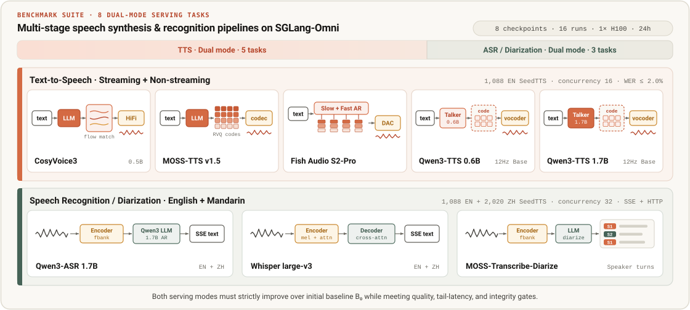

<a id="readme-top"></a>

<p align="center">
  
</p>

<h3 align="center">Can coding agents make real AI infrastructure faster?</h3>

<p align="center">
  <a href="https://index.openrsi.foundation/blog/2026/openrsi-sglang-omni/"></a>
  <a href="https://x.com/OpenRSI/status/2119869682929066288"></a>
  <a href="https://github.com/OpenRSI-Foundation/OpenRSI-Index"></a>
  <a href="https://github.com/sgl-project/sglang-omni"></a>
</p>

<p align="center">
  <a href="#leaderboard"><b>Leaderboard</b></a> ·
  <a href="#tasks"><b>Tasks</b></a> ·
  <a href="https://index.openrsi.foundation/logs/"><b>RSI Logs</b></a>
</p>

---

**OpenRSI-AI-Infra-Bench** benchmarks **recursive self-improvement (RSI) in real AI serving systems**. Agents iteratively optimize a serving stack with fixed model weights and GPU resources. An independent evaluator verifies speedups under quality and latency constraints; each accepted improvement becomes the next baseline.

Developed jointly by [OpenRSI and the SGLang-Omni team](https://index.openrsi.foundation/blog/2026/openrsi-sglang-omni/), the benchmark includes **8 carefully reviewed tasks for omni models**. Each task provides a production serving stack with pinned source code, assets, dependencies and evaluation protocols. The collection is part of the [OpenRSI Index](https://index.openrsi.foundation/).

<a id="highlights"></a>

## ✨ Highlights

- **Built with SGLang maintainers.** OpenRSI collaborated with SGLang-Omni maintainers to design tasks grounded in real-world production serving workloads. Agent-discovered optimizations have already resulted in [14 PRs merged upstream](https://github.com/sgl-project/sglang-omni/pulls?q=is%3Apr+state%3Aclosed+author%3AZhuofeng-Li).

- **Lightweight, single-GPU RSI.** Each task runs on just 1 × GPU, making iterative RSI experiments accessible without requiring large GPU clusters. Agents progressively improve serving throughput by building on their best results from previous rounds.

- **Fully open-source and reproducible.** We fully open-source the tasks, RSI harness, agent trajectories, and execution logs, enabling anyone to reproduce experiments, benchmark their agents on the leaderboard, and contribute new optimization strategies.

<a id="leaderboard"></a>

## 🏆 Leaderboard

Best verified score within the **first 24 hours** of each unguided single-agent run. **1.0× is the initial baseline; higher is better.** All runs use one H100 80GB HBM3 GPU.

**Codex:** `gpt-6-astra` · `xhigh` reasoning. **Claude Code:** `claude-opus-5-5` · `max` reasoning.

| Task | Track | Codex | Claude Code | Trajectories |
| :--- | :---: | ---: | ---: | :--- |
| [**CosyVoice3 (0.5B)**](https://github.com/OpenRSI-Foundation/OpenRSI-AI-Infra-Bench/tree/main/tasks/cosyvoice3-dual-mode) | 🗣️ TTS | [1.172×](https://index.openrsi.foundation/logs/#run=5e67e03919819ebb&tab=submissions) | [**1.297×**](https://index.openrsi.foundation/logs/#run=9de597863ceaafa7&tab=submissions) | [Codex ↗](https://index.openrsi.foundation/logs/#run=5e67e03919819ebb) · [Claude ↗](https://index.openrsi.foundation/logs/#run=9de597863ceaafa7) |
| [**MOSS-TTS v1.5**](https://github.com/OpenRSI-Foundation/OpenRSI-AI-Infra-Bench/tree/main/tasks/moss-tts-v1.5-dual-mode) | 🗣️ TTS | [1.339×](https://index.openrsi.foundation/logs/#run=770379d74c291ea5&tab=submissions) | [**1.935×**](https://index.openrsi.foundation/logs/#run=cd131351fd998975&tab=submissions) | [Codex ↗](https://index.openrsi.foundation/logs/#run=770379d74c291ea5) · [Claude ↗](https://index.openrsi.foundation/logs/#run=cd131351fd998975) |
| [**Fish Audio S2-Pro**](https://github.com/OpenRSI-Foundation/OpenRSI-AI-Infra-Bench/tree/main/tasks/fish-s2-pro-dual-mode) | 🗣️ TTS | [1.739×](https://index.openrsi.foundation/logs/#run=3a65be48b77269bd&tab=submissions) | [**6.288×**](https://index.openrsi.foundation/logs/#run=a2067dc23a561358&tab=submissions) | [Codex ↗](https://index.openrsi.foundation/logs/#run=3a65be48b77269bd) · [Claude ↗](https://index.openrsi.foundation/logs/#run=a2067dc23a561358) |
| [**Qwen3-TTS Base 0.6B**](https://github.com/OpenRSI-Foundation/OpenRSI-AI-Infra-Bench/tree/main/tasks/qwen3-tts-0.6b-dual-mode) | 🗣️ TTS | [1.141×](https://index.openrsi.foundation/logs/#run=c8f89a668fcb7e92&tab=submissions) | [**1.252×**](https://index.openrsi.foundation/logs/#run=4bdc101cfe415ada&tab=submissions) | [Codex ↗](https://index.openrsi.foundation/logs/#run=c8f89a668fcb7e92) · [Claude ↗](https://index.openrsi.foundation/logs/#run=4bdc101cfe415ada) |
| [**Qwen3-TTS Base 1.7B**](https://github.com/OpenRSI-Foundation/OpenRSI-AI-Infra-Bench/tree/main/tasks/qwen3-tts-1.7b-dual-mode) | 🗣️ TTS | [1.096×](https://index.openrsi.foundation/logs/#run=bb3980b8f4ef5741&tab=submissions) | [**1.283×**](https://index.openrsi.foundation/logs/#run=6ee3ceb2d4cacae3&tab=submissions) | [Codex ↗](https://index.openrsi.foundation/logs/#run=bb3980b8f4ef5741) · [Claude ↗](https://index.openrsi.foundation/logs/#run=6ee3ceb2d4cacae3) |
| [**Qwen3-ASR 1.7B**](https://github.com/OpenRSI-Foundation/OpenRSI-AI-Infra-Bench/tree/main/tasks/qwen3-asr-1.7b-dual-mode) | 👂 ASR | [1.117×](https://index.openrsi.foundation/logs/#run=536fb8d8084974b9&tab=submissions) | [**1.278×**](https://index.openrsi.foundation/logs/#run=f19f174bf5532f64&tab=submissions) | [Codex ↗](https://index.openrsi.foundation/logs/#run=536fb8d8084974b9) · [Claude ↗](https://index.openrsi.foundation/logs/#run=f19f174bf5532f64) |
| [**Whisper large-v3**](https://github.com/OpenRSI-Foundation/OpenRSI-AI-Infra-Bench/tree/main/tasks/whisper-large-v3-dual-mode) | 👂 ASR | [1.126×](https://index.openrsi.foundation/logs/#run=62020e82a96ad29a&tab=submissions) | [**1.979×**](https://index.openrsi.foundation/logs/#run=fb0a3a20e9dc5775&tab=submissions) | [Codex ↗](https://index.openrsi.foundation/logs/#run=62020e82a96ad29a) · [Claude ↗](https://index.openrsi.foundation/logs/#run=fb0a3a20e9dc5775) |
| [**MOSS-Transcribe-Diarize**](https://github.com/OpenRSI-Foundation/OpenRSI-AI-Infra-Bench/tree/main/tasks/moss-transcribe-diarize-dual-mode) | 👂 ASR | [1.134×](https://index.openrsi.foundation/logs/#run=5cd12dacf82da288&tab=submissions) | [**1.490×**](https://index.openrsi.foundation/logs/#run=85955c2d14726320&tab=submissions) | [Codex ↗](https://index.openrsi.foundation/logs/#run=5cd12dacf82da288) · [Claude ↗](https://index.openrsi.foundation/logs/#run=85955c2d14726320) |
<details>
<summary><strong>Scoring and comparison protocol</strong></summary>

Each mode's ratio is candidate mean throughput / initial B₀ mean throughput, with three repetitions per mean. Combine streaming (Rₛ) and non-streaming (Rₙ) as:

```math
\mathrm{score} = R_s^{2/3} \, R_n^{1/3}
```

ASR uses the geometric mean of English and Mandarin ratios within each mode. Modified candidates must improve both modes and pass all [quality, latency, streaming, and integrity gates](docs/evaluation.md).

Both agents are ranked by their best valid score within each run's first 24 hours, using that run's fixed B₀. See the [cutoff audit](results/README.md#evidence-and-limits) for hardware, protocol, and source-snapshot comparisons.

</details>

<a id="tasks"></a>

## 📦 Tasks

OpenRSI-AI-Infra-Bench targets omni model serving optimization in **SGLang-Omni**: improve both streaming and non-streaming throughput without degrading quality, latency, or streaming continuity. Its **8 tasks across 7 model families** cover core speech models for text-to-speech, recognition, and diarization. Each task is **self-contained and ready to run**, with pinned code, dependencies, model assets, and evaluators, plus reference throughput and GPU calibration instructions.

| Task package | Model checkpoint | SGLang-Omni base commit | Run command |
| :--- | :--- | :--- | :--- |
| [`cosyvoice3-dual-mode`](tasks/cosyvoice3-dual-mode/) | [`Fun-CosyVoice3-0.5B-2512`](https://huggingface.co/FunAudioLLM/Fun-CosyVoice3-0.5B-2512) | [`15235430`](https://github.com/sgl-project/sglang-omni/tree/1523543056bf334bc2f4d69db23aad0a002cedf2) | [Codex](docs/running.md#cosyvoice3-dual-mode-codex) · [Claude Code](docs/running.md#cosyvoice3-dual-mode-claude-code) |
| [`moss-tts-v1.5-dual-mode`](tasks/moss-tts-v1.5-dual-mode/) | [`MOSS-TTS-v1.5`](https://huggingface.co/OpenMOSS-Team/MOSS-TTS-v1.5) | [`cb75ab40`](https://github.com/sgl-project/sglang-omni/tree/cb75ab409669a6ab672fa42421b41b11af2fe263) | [Codex](docs/running.md#moss-tts-v1-5-dual-mode-codex) · [Claude Code](docs/running.md#moss-tts-v1-5-dual-mode-claude-code) |
| [`fish-s2-pro-dual-mode`](tasks/fish-s2-pro-dual-mode/) | [`fishaudio/s2-pro`](https://huggingface.co/fishaudio/s2-pro) | [`15235430`](https://github.com/sgl-project/sglang-omni/tree/1523543056bf334bc2f4d69db23aad0a002cedf2) | [Codex](docs/running.md#fish-s2-pro-dual-mode-codex) · [Claude Code](docs/running.md#fish-s2-pro-dual-mode-claude-code) |
| [`qwen3-tts-0.6b-dual-mode`](tasks/qwen3-tts-0.6b-dual-mode/) | [`Qwen3-TTS-12Hz-0.6B-Base`](https://huggingface.co/Qwen/Qwen3-TTS-12Hz-0.6B-Base) | [`15235430`](https://github.com/sgl-project/sglang-omni/tree/1523543056bf334bc2f4d69db23aad0a002cedf2) | [Codex](docs/running.md#qwen3-tts-0-6b-dual-mode-codex) · [Claude Code](docs/running.md#qwen3-tts-0-6b-dual-mode-claude-code) |
| [`qwen3-tts-1.7b-dual-mode`](tasks/qwen3-tts-1.7b-dual-mode/) | [`Qwen3-TTS-12Hz-1.7B-Base`](https://huggingface.co/Qwen/Qwen3-TTS-12Hz-1.7B-Base) | [`15235430`](https://github.com/sgl-project/sglang-omni/tree/1523543056bf334bc2f4d69db23aad0a002cedf2) | [Codex](docs/running.md#qwen3-tts-1-7b-dual-mode-codex) · [Claude Code](docs/running.md#qwen3-tts-1-7b-dual-mode-claude-code) |
| [`qwen3-asr-1.7b-dual-mode`](tasks/qwen3-asr-1.7b-dual-mode/) | [`Qwen3-ASR-1.7B`](https://huggingface.co/Qwen/Qwen3-ASR-1.7B) | [`eb7e97ed`](https://github.com/sgl-project/sglang-omni/tree/eb7e97ed9438ef4e4352656aec6170aeeb90966f) | [Codex](docs/running.md#qwen3-asr-1-7b-dual-mode-codex) · [Claude Code](docs/running.md#qwen3-asr-1-7b-dual-mode-claude-code) |
| [`whisper-large-v3-dual-mode`](tasks/whisper-large-v3-dual-mode/) | [`openai/whisper-large-v3`](https://huggingface.co/openai/whisper-large-v3) | [`eb7e97ed`](https://github.com/sgl-project/sglang-omni/tree/eb7e97ed9438ef4e4352656aec6170aeeb90966f) | [Codex](docs/running.md#whisper-large-v3-dual-mode-codex) · [Claude Code](docs/running.md#whisper-large-v3-dual-mode-claude-code) |
| [`moss-transcribe-diarize-dual-mode`](tasks/moss-transcribe-diarize-dual-mode/) | [`MOSS-Transcribe-Diarize`](https://huggingface.co/OpenMOSS-Team/MOSS-Transcribe-Diarize) | [`8220d220`](https://github.com/sgl-project/sglang-omni/tree/8220d220703cf8d8f5c5d9a2cde00b5ed13717b8) | [Codex](docs/running.md#moss-transcribe-diarize-dual-mode-codex) · [Claude Code](docs/running.md#moss-transcribe-diarize-dual-mode-claude-code) |

<p align="center">
  <picture>
    <source media="(prefers-color-scheme: dark)" srcset="assets/tasks-dark.svg">
    <source media="(prefers-color-scheme: light)" srcset="assets/tasks.svg">
    
  </picture>
</p>


<a id="quick-start"></a>

## 🚀 Quick start

**Requires:** A Linux host with an NVIDIA GPU (80 GB+ VRAM recommended).

This example runs `cosyvoice3-dual-mode` with a coding agent. Open Codex or Claude Code on your GPU host and paste the prompt below.

```text
Run the cosyvoice3-dual-mode benchmark on GPU 0 from:
https://github.com/OpenRSI-Foundation/OpenRSI-AI-Infra-Bench

Clone the repository and follow docs/running.md to check the
environment, install RSI-Harness, configure the available coding
agent, and calibrate the baseline if needed. Start a coding-agent
optimization run, troubleshoot any setup or execution failures,
and inspect the results.

When finished, report the task score, run ID, and artifact paths.
If credentials are missing or you encounter a blocker you cannot
resolve, tell me exactly what is needed.
```

Replace `cosyvoice3-dual-mode` with any [task slug](#tasks) to run a different benchmark. See the [full guide](docs/running.md) for configuration and hardware requirements.

<a id="how-it-works"></a>

<details>
<summary><strong>⚙️ How it works</strong></summary>

1. **Optimize.** A coding agent profiles and edits the serving runtime in a persistent container, with fixed model weights and one GPU.
2. **Evaluate.** Each submitted candidate is tested in a fresh Judge container against the fixed initial B₀, using three repetitions per mode.
3. **Iterate.** The agent uses the evaluator's feedback to improve its next submission. The leaderboard reports the highest valid score within 24 hours.

[RSI-Harness architecture](docs/how-it-works.md) · [Quality and latency gates](docs/evaluation.md) · [Run your own agent](docs/running.md) · [Upstream PRs & patterns](docs/upstream-results.md)

</details>

<a id="contributors"></a>

## 🤝 Core Contributors

<table>
  <tr>
    <td align="center" width="16.67%"><a href="https://zhuofeng-li.github.io/"><strong>Zhuofeng Li</strong></a></td>
    <td align="center" width="16.67%"><a href="https://github.com/db-ol"><strong>Aaron Tian</strong></a></td>
    <td align="center" width="16.67%"><a href="https://yichenfeng.me/"><strong>Yichen Feng</strong></a></td>
    <td align="center" width="16.67%"><a href="https://wenhaochai.com/"><strong>Wenhao Chai</strong></a></td>
    <td align="center" width="16.67%"><a href="https://weikangda.github.io/kangda.github.io/"><strong>Kangda Wei</strong></a></td>
    <td align="center" width="16.67%"><a href=""><strong>Simon Yu</strong></a></td>
  </tr>
  <tr>
    <td align="center" width="16.67%"><a href="https://davidhanx.github.io/"><strong>Xinyang Han</strong></a></td>
    <td align="center" width="16.67%"><a href="https://caralinotes.com/"><strong>Cara Li</strong></a></td>
    <td align="center" width="16.67%"><a href="https://vincentcaptain.github.io/"><strong>Shujia Liang</strong></a></td>
    <td align="center" width="16.67%"><a href="https://yuetl9.github.io/"><strong>Yuetai Li</strong></a></td>
    <td align="center" width="16.67%"><a href="https://github.com/zhaochenyang20"><strong>Chenyang Zhao</strong></a></td>
  </tr>
</table>

<a id="contributing"></a>

## ✨ Contributing

To contribute a benchmark, see the [OpenRSI call for contributors](https://github.com/OpenRSI-Foundation/OpenRSI-Index#-call-for-contributors) and open a pull request. If your agent develops a useful optimization, PRs to [SGLang Omni](https://github.com/sgl-project/sglang-omni) are also welcome.

<a id="citation"></a>

## 📖 Citation

If you find OpenRSI-AI-Infra-Bench useful in your research or engineering, please cite:

```bibtex
@misc{li2026openrsisglangomni,
  title  = {{OpenRSI} $\times$ {SGLang-Omni}: Scaling {RSI} for {AI} Infra},
  author = {Li, Zhuofeng and Tian, Aaron and Feng, Yichen and Chai, Wenhao and
            Han, Xinyang and Li, Cara and Liang, Shujia and Li, Yuetai and
            Zhao, Chenyang},
  year   = {2026},
  month  = nov,
  url    = {https://index.openrsi.foundation/blog/2026/openrsi-sglang-omni/}
}
```

<p align="right"><a href="#readme-top">↑ Back to top</a></p>

---

<p align="center">
  Built by the <a href="https://github.com/OpenRSI-Foundation"><b>OpenRSI Foundation</b></a>
  with the <a href="https://github.com/sgl-project/sglang-omni"><b>SGLang-Omni</b></a> community.
</p>
