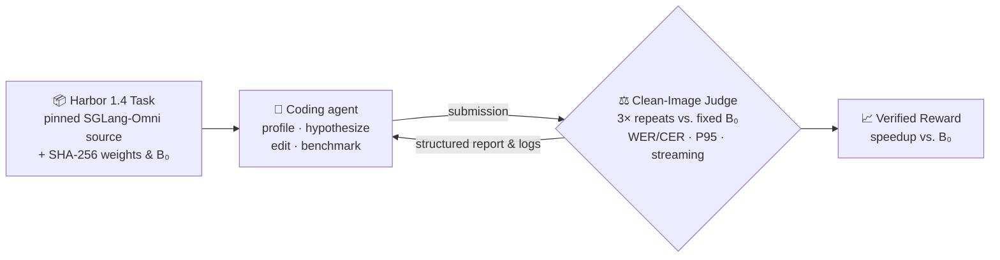

<p align="center">
  
</p>

<h3 align="center">Can coding agents make real AI infrastructure faster?</h3>

<p align="center">
  <a href="https://index.openrsi.foundation/blog/2026/openrsi-sglang-omni/">Blog</a> ·
  <a href="https://index.openrsi.foundation">OpenRSI Index</a> ·
  <a href="#-leaderboard">Leaderboard</a> ·
  <a href="#-tasks">Tasks</a> ·
  <a href="#-quick-start">Quick Start</a> ·
  <a href="#-evaluation">Evaluation</a> ·
  <a href="https://index.openrsi.foundation/logs/">Logs Viewer</a> ·
  <a href="https://huggingface.co/datasets/OpenRSI-Foundation/OpenRSI-Index-Logs/tree/main/sglang-omni">HF Dataset</a> ·
  <a href="https://github.com/OpenRSI-Foundation/OpenRSI-Index/tree/main/RSI-Harness">RSI-Harness</a> ·
  <a href="https://github.com/sgl-project/sglang-omni">SGLang-Omni</a>
</p>

<p align="center">
  <a href="https://index.openrsi.foundation/blog/2026/openrsi-sglang-omni/"></a>
  <a href="#-tasks"></a>
  <a href="https://index.openrsi.foundation/logs/"></a>
  <a href="#-leaderboard"></a>
  <a href="#-from-benchmark-to-upstream"></a>
  <a href="LICENSE"></a>
</p>

**OpenRSI-AI-Infra-Bench** benchmarks **recursive self-improvement (RSI) in real AI serving systems**. Agents iteratively profile, hypothesize, and rewrite a production serving stack under fixed model weights and single-GPU budgets; an isolated clean-image Judge verifies speedups against the starting baseline $B_0$ under strict **speech intelligibility, tail-latency, and streaming-continuity constraints**.

Developed [jointly by OpenRSI and the SGLang-Omni team](https://index.openrsi.foundation/blog/2026/openrsi-sglang-omni/) as the AI Infrastructure track of [OpenRSI Index](https://github.com/OpenRSI-Foundation/OpenRSI-Index) (`rsi-tasks/sglang-omni/`), this repository packages **12 natively `rsi-harness`-runnable Harbor 1.4 benchmarks** across **10 open-weight model checkpoints (8 model families)**—9 Text-to-Speech (TTS) tasks and 3 Automatic Speech Recognition / Diarization (ASR) tasks—paired with **21 complete uncompressed single-agent trajectories**.

## 🏆 Leaderboard

Two coding agents, evaluated in unguided single-agent [RSI-Harness](https://github.com/OpenRSI-Foundation/OpenRSI-Index/tree/main/RSI-Harness) runs:

| Agent | Model | Reasoning effort |
| :--- | :--- | :---: |
| **Codex** | `gpt-6-astra` | `xhigh` |
| **Claude Code** | `claude-opus-5-5` | `max` |

Below is the **best verified Judge reward per task and agent** across all **21 published single-agent trajectories**. **Higher is better; 1.000× is the starting baseline $B_0$.** Click any score to open that run's interactive evaluation curve and full tool-call transcript in the [RSI Logs Viewer](https://index.openrsi.foundation/logs/), or open `HF ↗` for the raw uncompressed files.

| Task | Track | Mode | Codex | Claude Code | Raw Archive |
| :--- | :---: | :--- | ---: | ---: | :--- |
| **[CosyVoice3 (0.5B)](tasks/cosyvoice3-dual-mode/)** · [Sample ↗](https://index.openrsi.foundation/tasks/cosyvoice3-dual-mode.html) | 🗣️ TTS | Dual mode | [1.172×](https://index.openrsi.foundation/logs/#run=5e67e03919819ebb) | [**1.297×**](https://index.openrsi.foundation/logs/#run=9de597863ceaafa7) | [HF ↗](https://huggingface.co/datasets/OpenRSI-Foundation/OpenRSI-Index-Logs/tree/main/sglang-omni/cosyvoice3-dual-mode) |
| **[MOSS-TTS v1.5](tasks/moss-tts-v1.5-dual-mode/)** | 🗣️ TTS | Dual mode | [1.339×](https://index.openrsi.foundation/logs/#run=770379d74c291ea5) | [**1.935×**](https://index.openrsi.foundation/logs/#run=cd131351fd998975) | [HF ↗](https://huggingface.co/datasets/OpenRSI-Foundation/OpenRSI-Index-Logs/tree/main/sglang-omni/moss-tts-v1.5-dual-mode) |
| **[Fish Audio S2-Pro](tasks/fish-s2-pro-dual-mode/)** | 🗣️ TTS | Dual mode | [1.803×](https://index.openrsi.foundation/logs/#run=3a65be48b77269bd) | [**6.288×**](https://index.openrsi.foundation/logs/#run=a2067dc23a561358) | [HF ↗](https://huggingface.co/datasets/OpenRSI-Foundation/OpenRSI-Index-Logs/tree/main/sglang-omni/fish-s2-pro-dual-mode) |
| **[Qwen3-TTS Base 0.6B](tasks/qwen3-tts-0.6b-dual-mode/)** | 🗣️ TTS | Dual mode | [1.141×](https://index.openrsi.foundation/logs/#run=c8f89a668fcb7e92) | [**1.252×**](https://index.openrsi.foundation/logs/#run=4bdc101cfe415ada) | [HF ↗](https://huggingface.co/datasets/OpenRSI-Foundation/OpenRSI-Index-Logs/tree/main/sglang-omni/qwen3-tts-0.6b-dual-mode) |
| **[Qwen3-TTS Base 1.7B](tasks/qwen3-tts-1.7b-dual-mode/)** | 🗣️ TTS | Dual mode | [1.096×](https://index.openrsi.foundation/logs/#run=bb3980b8f4ef5741) | [**1.283×**](https://index.openrsi.foundation/logs/#run=6ee3ceb2d4cacae3) | [HF ↗](https://huggingface.co/datasets/OpenRSI-Foundation/OpenRSI-Index-Logs/tree/main/sglang-omni/qwen3-tts-1.7b-dual-mode) |
| **[Ming3-TTS 0.5B](tasks/ming3-tts-0.5b-nonstream/)** | 🗣️ TTS | Non-streaming | — | [**4.298×**†](https://index.openrsi.foundation/logs/#run=e7daa9d0dcc71af4) | [HF ↗](https://huggingface.co/datasets/OpenRSI-Foundation/OpenRSI-Index-Logs/tree/main/sglang-omni/ming3-tts-0.5b-nonstream) |
| **[Ming3-TTS 0.5B](tasks/ming3-tts-0.5b-streaming/)** | 🗣️ TTS | Streaming | [**2.038×**](https://index.openrsi.foundation/logs/#run=a9073807b4975864) | — | [HF ↗](https://huggingface.co/datasets/OpenRSI-Foundation/OpenRSI-Index-Logs/tree/main/sglang-omni/ming3-tts-0.5b-streaming) |
| **[Ming3-TTS Tiny](tasks/ming3-tts-tiny-nonstream/)** | 🗣️ TTS | Non-streaming | [1.899×¹](https://index.openrsi.foundation/logs/#run=5da5fe181e667430) | [**3.634×**](https://index.openrsi.foundation/logs/#run=283899e5e2403399) | [HF ↗](https://huggingface.co/datasets/OpenRSI-Foundation/OpenRSI-Index-Logs/tree/main/sglang-omni/ming3-tts-tiny-nonstream) |
| **[Ming3-TTS Tiny](tasks/ming3-tts-tiny-streaming/)** | 🗣️ TTS | Streaming | [**1.722×**](https://index.openrsi.foundation/logs/#run=4dc68c591bbcb7cf) | — | [HF ↗](https://huggingface.co/datasets/OpenRSI-Foundation/OpenRSI-Index-Logs/tree/main/sglang-omni/ming3-tts-tiny-streaming) |
| **[Qwen3-ASR 1.7B](tasks/qwen3-asr-1.7b-dual-mode/)** | 👂 ASR | Dual mode | [1.117×](https://index.openrsi.foundation/logs/#run=536fb8d8084974b9) | [**1.317×**†](https://index.openrsi.foundation/logs/#run=f19f174bf5532f64) | [HF ↗](https://huggingface.co/datasets/OpenRSI-Foundation/OpenRSI-Index-Logs/tree/main/sglang-omni/qwen3-asr-1.7b-dual-mode) |
| **[Whisper large-v3](tasks/whisper-large-v3-dual-mode/)** | 👂 ASR | Dual mode | [1.126×](https://index.openrsi.foundation/logs/#run=62020e82a96ad29a) | [**1.979×**†](https://index.openrsi.foundation/logs/#run=fb0a3a20e9dc5775) | [HF ↗](https://huggingface.co/datasets/OpenRSI-Foundation/OpenRSI-Index-Logs/tree/main/sglang-omni/whisper-large-v3-dual-mode) |
| **[MOSS-Transcribe-Diarize](tasks/moss-transcribe-diarize-dual-mode/)** | 👂 ASR | Dual mode | [1.134×](https://index.openrsi.foundation/logs/#run=5cd12dacf82da288) | [**1.490×**](https://index.openrsi.foundation/logs/#run=85955c2d14726320) | [HF ↗](https://huggingface.co/datasets/OpenRSI-Foundation/OpenRSI-Index-Logs/tree/main/sglang-omni/moss-transcribe-diarize-dual-mode) |

<sub>
† Run stopped as <code>cancelled</code> after ~12.2 h (`ming3-tts-0.5b-nonstream`) or ~24.0–24.4 h (`qwen3-asr-1.7b-dual-mode`, `whisper-large-v3-dual-mode`), retaining the highest earlier verified Judge submission.<br>
¹ `ming3-tts-tiny-nonstream` Codex (`1.899×`, 32 submissions, 14.91 h) continued 4 minutes after an initial warm segment (`1.358×`, 13 submissions, 8.77 h), totaling 23.68 h within the 24 h single-agent budget.<br>
Calibration/preparation runs, guided-prompt ablations, and multi-agent framework runs are excluded so every entry reflects unguided single-agent optimization.
</sub>

<details>
<summary><strong>Hardware, budgets and version notes</strong></summary>

- **Dual-mode tasks (8 tasks):** Measured on **NVIDIA H100 80GB HBM3** over ~24-hour budgets. `cosyvoice3-dual-mode` ships at the exact unguided SGLang-Omni `1523543056bf` commit measured by both Main baselines (`1.172×` and `1.297×`).
- **Ming3-TTS single-mode tasks (4 tasks):** Non-streaming baselines used **H100 NVL** (Claude Code) and **H200** (Codex); streaming baselines used **H200** (8-hour recorded runs; standardized to a 24-hour `86400s` default ceiling in `task.toml`).
- Because hardware SKUs and recorded runtimes vary across historical runs, we report per-task verified rewards rather than an aggregate cross-task win rate.

</details>

📊 [Run records & methodology](results/README.md) ·
🗂️ [Machine-readable JSON](results/main.json) ·
📋 [Published runs CSV](results/runs.csv) ·
🔍 [Interactive RSI Logs Viewer](https://index.openrsi.foundation/logs/)

## 📰 News

- **2026.11** — 🚀 **Refined benchmark & full trajectories released**: All 12 SGLang-Omni tasks are now unified onto native Harbor 1.4 (`rsi-harness run` out of the box, `-89.6%` repo size reduction, hardened Judge gates) alongside **21 uncompressed single-agent trajectories** on [Hugging Face](https://huggingface.co/datasets/OpenRSI-Foundation/OpenRSI-Index-Logs/tree/main/sglang-omni) and the [Logs Viewer](https://index.openrsi.foundation/logs/).
- **2026.11** — 📝 Blog: **[OpenRSI × SGLang-Omni: Scaling RSI for AI Infra](https://index.openrsi.foundation/blog/2026/openrsi-sglang-omni/)**.
  Agent-found optimizations raised throughput by **+7.6% to +326.5%** on H100 across eight omni model families; **14 PRs** were reviewed and merged by SGLang-Omni maintainers.

## ✨ Highlights

<table>
  <tr>
    <td align="center" width="20%"><h3>12</h3></td>
    <td align="center" width="20%"><h3>10</h3></td>
    <td align="center" width="20%"><h3>21</h3></td>
    <td align="center" width="20%"><h3>6.29×</h3></td>
    <td align="center" width="20%"><h3>14</h3></td>
  </tr>
  <tr>
    <td align="center">Harbor 1.4 tasks</td>
    <td align="center">Model checkpoints<br/><sub>(8 families)</sub></td>
    <td align="center">Public single-agent<br/>trajectories</td>
    <td align="center">Peak verified<br/>speedup</td>
    <td align="center">Upstream PRs<br/>merged</td>
  </tr>
</table>

- **100% native `rsi-harness run` across TTS & ASR.** One uniform CLI entrypoint for every task—no external `launch.py` wrappers or stateful rolling-baseline adapters. `--agent oracle` validates any task end-to-end on 1 GPU (`reward = 1.0`).
- **Isolated clean-image Judge & automatic NUMA pinning.** Every submission runs 3 fresh repetitions per mode in a clean Judge container, automatically binding **16 idle non-SMT physical CPU cores** on the GPU's NUMA node and enforcing `peak_foreign_cores <= 2.0`. Non-reference GPUs can recalibrate $B_0$ once via `/tests/calibrate.py` (`RSI_BASELINE_JSON`).
- **Hardened streaming, quality & anti-cheat gates.** Verifies true incremental delivery (`>= 95%` multi-chunk audio & `c50 >= 95%` on TTS; `single_delta_fraction <= 5%` on ASR; `>= 80%` diarization speaker markers on MOSS-TD), `Qwen3-ASR-1.7B` / bilingual SeedTTS intelligibility ceilings, frozen weights/sampling configs, and AST + call-site liveness.
- **Every iteration open & inspectable.** Full agent prompts, reasoning traces, code diffs, and round-by-round Judge reports for all 21 runs are open in [OpenRSI-Index-Logs](https://huggingface.co/datasets/OpenRSI-Foundation/OpenRSI-Index-Logs/tree/main/sglang-omni).

## ⚙️ How it works



RSI-Harness orchestrates the outer loop: the agent iterates inside an offline container (`/workspace/sglang-omni`) with 1 GPU and submits candidates; each submission is mounted read-only into a fresh Judge container that benchmarks throughput from scratch against the fixed reference baseline $B_0$.

Each standalone package under `tasks/` follows the Harbor 1.4 layout:

```text
tasks/<task-slug>/
├── task.toml           # Harbor 1.4 resources, 24h budget, clean-image Judge config
├── instruction.md      # Self-contained agent prompt, allowed scope & evaluation contract
├── README.md           # Reference B0 table, logged baselines & GPU recalibration guide
├── environment/        # Pinned Dockerfile, lockfiles & trimmed SGLang-Omni source.tar.gz
├── solution/solve.sh   # Restores pristine baseline source (--agent oracle -> reward 1.0)
└── tests/              # Clean-image evaluator, baseline.json, calibrate.py & gates
```

## 📦 Tasks

Technical specification across all **12 benchmark packages** (reference $B_0$ throughput is the 3-repetition mean in `tests/baseline.json`; `NS` = non-streaming, `S` = streaming):

| Package | Model Checkpoint | `sglang-omni` Base | Reference $B_0$ Throughput (`req/s`) | Primary Quality & Streaming Gates |
| :--- | :--- | :---: | :--- | :--- |
| [`cosyvoice3-dual-mode`](tasks/cosyvoice3-dual-mode/) | [`Fun-CosyVoice3-0.5B-2512`](https://huggingface.co/FunAudioLLM/Fun-CosyVoice3-0.5B-2512) | [`15235430`](https://github.com/sgl-project/sglang-omni/tree/1523543056bf334bc2f4d69db23aad0a002cedf2) | `9.06` NS / `7.52` S <sub>(H100 SXM)</sub> | WER $\le 2.0\%$, P95 $+3\%$, `c50` $\ge 95\%$, $\ge 95\%$ multi-chunk |
| [`moss-tts-v1.5-dual-mode`](tasks/moss-tts-v1.5-dual-mode/) | [`MOSS-TTS-v1.5`](https://huggingface.co/OpenMOSS-Team/MOSS-TTS-v1.5) | [`cb75ab40`](https://github.com/sgl-project/sglang-omni/tree/cb75ab409669a6ab672fa42421b41b11af2fe263) | `7.86` NS / `6.56` S <sub>(H100 SXM)</sub> | WER $\le 2.0\%$, P95 $+3\%$, `c50` $\ge 95\%$, $\ge 95\%$ multi-chunk |
| [`fish-s2-pro-dual-mode`](tasks/fish-s2-pro-dual-mode/) | [`fishaudio/s2-pro`](https://huggingface.co/fishaudio/s2-pro) | [`15235430`](https://github.com/sgl-project/sglang-omni/tree/1523543056bf334bc2f4d69db23aad0a002cedf2) | `1.25` NS / `1.24` S <sub>(H100 SXM)</sub> | WER $\le 2.0\%$, P95 $+3\%$, `c50` $\ge 95\%$, $\ge 95\%$ multi-chunk |
| [`qwen3-tts-0.6b-dual-mode`](tasks/qwen3-tts-0.6b-dual-mode/) | [`Qwen3-TTS-12Hz-0.6B-Base`](https://huggingface.co/Qwen/Qwen3-TTS-12Hz-0.6B-Base) | [`15235430`](https://github.com/sgl-project/sglang-omni/tree/1523543056bf334bc2f4d69db23aad0a002cedf2) | `17.58` NS / `19.38` S <sub>(H100 SXM)</sub> | WER $\le 2.0\%$, P95 $+3\%$, `c50` $\ge 95\%$, $\ge 95\%$ multi-chunk |
| [`qwen3-tts-1.7b-dual-mode`](tasks/qwen3-tts-1.7b-dual-mode/) | [`Qwen3-TTS-12Hz-1.7B-Base`](https://huggingface.co/Qwen/Qwen3-TTS-12Hz-1.7B-Base) | [`15235430`](https://github.com/sgl-project/sglang-omni/tree/1523543056bf334bc2f4d69db23aad0a002cedf2) | `18.79` NS / `19.97` S <sub>(H100 SXM)</sub> | WER $\le 2.0\%$, P95 $+3\%$, `c50` $\ge 95\%$, $\ge 95\%$ multi-chunk |
| [`ming3-tts-0.5b-nonstream`](tasks/ming3-tts-0.5b-nonstream/) | [`Ming-3.0-tts-0.5B`](https://huggingface.co/inclusionAI/Ming-3.0-tts-0.5B) | [`ca9e8789`](https://github.com/sgl-project/sglang-omni/tree/ca9e8789fcd84ed6f7272276cb99447eec751787) | `8.77` NS <sub>(H100 NVL)</sub> | WER $\le 2.0\%$, latency & RTF P95 $\le 1.03 \times B_0$ |
| [`ming3-tts-0.5b-streaming`](tasks/ming3-tts-0.5b-streaming/) | [`Ming-3.0-tts-0.5B`](https://huggingface.co/inclusionAI/Ming-3.0-tts-0.5B) | [`0c663861`](https://github.com/sgl-project/sglang-omni/tree/0c663861d7d4a558e4f53258c4d48cfce577b47e) | `14.99` S <sub>(H200)</sub> | WER $\le 2.0\%$, TTFA P95 $+3\%$, `c50` $\ge 95\%$, $\ge 95\%$ multi-chunk |
| [`ming3-tts-tiny-nonstream`](tasks/ming3-tts-tiny-nonstream/) | [`Ming-3.0-tts-tiny`](https://huggingface.co/inclusionAI/Ming-3.0-tts-tiny) | [`ca9e8789`](https://github.com/sgl-project/sglang-omni/tree/ca9e8789fcd84ed6f7272276cb99447eec751787) | `5.91` NS <sub>(H100 NVL)</sub> | WER $\le 2.0\%$, latency & RTF P95 $\le 1.03 \times B_0$ |
| [`ming3-tts-tiny-streaming`](tasks/ming3-tts-tiny-streaming/) | [`Ming-3.0-tts-tiny`](https://huggingface.co/inclusionAI/Ming-3.0-tts-tiny) | [`0c663861`](https://github.com/sgl-project/sglang-omni/tree/0c663861d7d4a558e4f53258c4d48cfce577b47e) | `5.31` S <sub>(H200)</sub> | WER $\le 2.0\%$, TTFA P95 $+3\%$, `c50` $\ge 95\%$, $\ge 95\%$ multi-chunk |
| [`qwen3-asr-1.7b-dual-mode`](tasks/qwen3-asr-1.7b-dual-mode/) | [`Qwen3-ASR-1.7B`](https://huggingface.co/Qwen/Qwen3-ASR-1.7B) | [`eb7e97ed`](https://github.com/sgl-project/sglang-omni/tree/eb7e97ed9438ef4e4352656aec6170aeeb90966f) | EN `168.9 / 160.6` · ZH `179.8 / 172.1` <sub>(H100 SXM)</sub> | EN/ZH error $\le 2.0\%$, TTFT P95 $+3\%$, `single_delta` $\le 5\%$ |
| [`whisper-large-v3-dual-mode`](tasks/whisper-large-v3-dual-mode/) | [`openai/whisper-large-v3`](https://huggingface.co/openai/whisper-large-v3) | [`eb7e97ed`](https://github.com/sgl-project/sglang-omni/tree/eb7e97ed9438ef4e4352656aec6170aeeb90966f) | EN `53.2 / 52.4` · ZH `48.6 / 48.6` <sub>(H100 SXM)</sub> | EN/ZH error $\le 1.03 \times B_0$, TTFT P95 $+3\%$, `single_delta` $\le 5\%$ |
| [`moss-transcribe-diarize-dual-mode`](tasks/moss-transcribe-diarize-dual-mode/) | [`MOSS-Transcribe-Diarize`](https://huggingface.co/OpenMOSS-Team/MOSS-Transcribe-Diarize) | [`8220d220`](https://github.com/sgl-project/sglang-omni/tree/8220d220703cf8d8f5c5d9a2cde00b5ed13717b8) | EN `106.8 / 102.2` · ZH `109.6 / 105.5` <sub>(H100 SXM)</sub> | EN/ZH error $\le 1.03 \times B_0$, `single_delta` $\le 5\%$, $\ge 80\%$ speaker tags |

> [!NOTE]
> For TTS, *streaming* means incremental multi-chunk PCM audio delivery over HTTP (`chunk_count >= 2` on $\ge 95\%$ of requests and `c50 >= 95%`). For ASR, it means incremental SSE text deltas (`single_delta_fraction <= 5%`) after audio upload, evaluated across 1,088 English and 2,020 Mandarin SeedTTS utterances per repetition.

## 🔁 From benchmark to upstream

The same harnessed loop was used to land real optimizations in SGLang-Omni.
Agents did the performance work; people defined the problems and reviewed the PRs.
Throughput gains on **H100** (non-streaming / streaming), measured on
`sglang-omni` main before the first and after the last OpenRSI PR:

| Model | Merged PRs | Non-streaming | Streaming |
| :--- | :--- | ---: | ---: |
| CosyVoice3 | [#2524](https://github.com/sgl-project/sglang-omni/pull/2524) [#2555](https://github.com/sgl-project/sglang-omni/pull/2555) | +44.4% | +46.2% |
| MOSS-TTS | [#2525](https://github.com/sgl-project/sglang-omni/pull/2525) [#2859](https://github.com/sgl-project/sglang-omni/pull/2859) | +48.5% | +76.3% |
| Fish S2-Pro | [#2778](https://github.com/sgl-project/sglang-omni/pull/2778) | +9.6% | +0.3% |
| Qwen3-TTS | [#2779](https://github.com/sgl-project/sglang-omni/pull/2779) | +25.2% | +4.7% |
| Qwen3-ASR | [#2880](https://github.com/sgl-project/sglang-omni/pull/2880) [#2881](https://github.com/sgl-project/sglang-omni/pull/2881) [#2882](https://github.com/sgl-project/sglang-omni/pull/2882) | +14.2% | +5.0% |
| Whisper large-v3 | [#2901](https://github.com/sgl-project/sglang-omni/pull/2901) | +7.6% | +12.2% |
| MOSS-Transcribe-Diarize | [#3071](https://github.com/sgl-project/sglang-omni/pull/3071) | +18.8% | +30.0% |
| Ming3-TTS 0.5B | [#3136](https://github.com/sgl-project/sglang-omni/pull/3136) [#3189](https://github.com/sgl-project/sglang-omni/pull/3189) [#3190](https://github.com/sgl-project/sglang-omni/pull/3190) | **+326.5%** | **+93.9%** |

<sub>These upstream numbers come from a separate measurement protocol than the benchmark
rewards above, and some ranges include non-OpenRSI changes. See the
<a href="https://index.openrsi.foundation/blog/2026/openrsi-sglang-omni/">blog post</a>
for H200 results, per-PR caveats and the five recurring optimization patterns
(idle-thread spinning, per-hop data conversion, unused work, small GPU launches, and
unpipelined prefill/decode).</sub>

## 🚀 Quick start

### 1. Clone and verify task integrity

Clone this repository directly—or pull it as the `rsi-tasks/sglang-omni` submodule inside `OpenRSI-Index`:

```bash
# Option A: standalone repository
git clone https://github.com/OpenRSI-Foundation/OpenRSI-AI-Infra-Bench.git
cd OpenRSI-AI-Infra-Bench

# Option B: via OpenRSI-Index
git clone --recurse-submodules https://github.com/OpenRSI-Foundation/OpenRSI-Index.git
cd OpenRSI-Index/rsi-tasks/sglang-omni

# Verify all 12 task manifests, SHA-256 hashes, and Python/JSON/TOML/shell syntax (CPU-only)
python3 -B scripts/verify.py
```

### 2. Install RSI-Harness and validate with `--agent oracle`

**Requirements:** Linux, Docker Engine 26+, NVIDIA Container Toolkit, Python 3.12, 1 GPU (80 GB+ VRAM recommended), 16 idle physical CPU cores, 128 GiB RAM, and ~200 GiB free SSD storage.

Install [RSI-Harness](https://github.com/OpenRSI-Foundation/OpenRSI-Index/tree/main/RSI-Harness), then run `--agent oracle` on any TTS or ASR task to verify Docker image build, NUMA core pinning, and full 3-repetition evaluation (`reward = 1.0`):

```bash
rsi-harness run tasks/cosyvoice3-dual-mode --agent oracle --gpus 0
rsi-harness run tasks/qwen3-asr-1.7b-dual-mode --agent oracle --gpus 0
```

### 3. Run a coding agent

All 12 TTS and ASR tasks share the exact same `rsi-harness run` interface:

```bash
TASK_DIR="$PWD/tasks/cosyvoice3-dual-mode"

# Codex
rsi-harness run "$TASK_DIR" \
  --agent codex --model gpt-6-astra --reasoning-effort xhigh \
  --agent-auth local --gpus 0

# Claude Code
rsi-harness run "$TASK_DIR" \
  --agent claude-code --model claude-opus-5-5 --reasoning-effort max \
  --agent-auth local --gpus 0
```

> [!TIP]
> **Custom GPU SKUs (`RSI_BASELINE_JSON`):** Each task bakes reference $B_0$ metrics into `tests/baseline.json`. When running optimization loops on a different GPU SKU (e.g., PCIe H100 NVL vs. SXM5 H100, or A100/B200), measure a fresh 3-repetition $B_0$ once with `/opt/sglang/bin/python3 -I -B /tests/calibrate.py` and export `RSI_BASELINE_JSON`—see [docs/running.md](docs/running.md#4-optional-recalibrating-reference-b_0-for-custom-gpu-skus).

### 4. Inspect local runs or download the 21 baseline trajectories

```bash
# Visualize local RSI-Harness runs at http://127.0.0.1:8000
rsi-harness visualize

# Download one task's published trajectories (or omit --include for all 21 runs)
hf download OpenRSI-Foundation/OpenRSI-Index-Logs --repo-type dataset \
  --include "sglang-omni/cosyvoice3-dual-mode/*" --local-dir OpenRSI-Index-Logs
```

📖 **[Full setup, GPU calibration and execution guide →](docs/running.md)**

## ⚖️ Evaluation

The target is **serving throughput**, subject to each task's quality, tail-latency,
streaming-continuity, resource and integrity gates. A faster implementation is rejected if it violates any guard.

For all eight dual-mode tasks (TTS and ASR), let $R_s$ and $R_n$ be the streaming and non-streaming throughput ratios against the reference baseline $B_0$ (for ASR, each mode ratio is the geometric mean across English and Mandarin):

$$
\mathrm{reward} = R_s^{2/3} \, R_n^{1/3}.
$$

**Both modes must strictly improve** over $B_0$ (`> 1.0`) for modified candidates, preventing a gain in one mode from masking a regression in the other. Ming3's four single-mode tasks score the target mode's throughput ratio against $B_0$.

| | Workload and checks |
| :--- | :--- |
| **TTS (9 tasks)** | 1,088 English SeedTTS requests per repetition; concurrency 16; 3 repetitions per mode; independent `Qwen3-ASR-1.7B` WER verification ($\le 2.0\%$), $3\%$ latency/RTF/TTFA P95 budgets, and $\ge 95\%$ multi-chunk streaming (`c50` $\ge 95\%$) |
| **ASR (3 tasks)** | 1,088 English + 2,020 Mandarin SeedTTS requests per repetition; non-streaming HTTP and post-upload SSE; 3 repetitions per language and mode; strict WER/CER ceilings, `single_delta_fraction` $\le 5\%$, and $\ge 80\%$ speaker-turn tags on MOSS-TD |
| **System guards** | Automatic NUMA-local 16-physical-core pinning, host contention gate (`peak_foreign_cores <= 2.0`), frozen weights & sampling semantics, AST & call-site liveness checks, and `0 MiB` GPU process cleanup |

## 🔗 Resources

| Resource | Link |
| :--- | :--- |
| Blog post | [OpenRSI × SGLang-Omni: Scaling RSI for AI Infra](https://index.openrsi.foundation/blog/2026/openrsi-sglang-omni/) |
| Interactive Logs Viewer | [index.openrsi.foundation/logs](https://index.openrsi.foundation/logs/) (all 21 single-agent runs) |
| Trajectory dataset | [OpenRSI-Foundation/OpenRSI-Index-Logs (`sglang-omni/`)](https://huggingface.co/datasets/OpenRSI-Foundation/OpenRSI-Index-Logs/tree/main/sglang-omni) |
| Featured Task Sample | [CosyVoice3 Dual-Mode (`cosyvoice3-dual-mode`)](https://index.openrsi.foundation/tasks/cosyvoice3-dual-mode.html) |
| OpenRSI Index | [index.openrsi.foundation](https://index.openrsi.foundation) · [GitHub](https://github.com/OpenRSI-Foundation/OpenRSI-Index) (`rsi-tasks/sglang-omni`) |
| Runner | [RSI-Harness](https://github.com/OpenRSI-Foundation/OpenRSI-Index/tree/main/RSI-Harness) |
| Serving framework | [SGLang-Omni](https://github.com/sgl-project/sglang-omni) |
| Task collection | [Browse `tasks/`](tasks/) · [Running guide](docs/running.md) · [Baseline records](results/README.md) |
| Contribute a task | [Call for contributors](https://github.com/OpenRSI-Foundation/OpenRSI-Index#-call-for-contributors) |

## 📜 Provenance and license

The benchmark tasks originate from OpenRSI Index discussions [#154](https://github.com/OpenRSI-Foundation/OpenRSI-Index/discussions/154) (TTS) and [#257](https://github.com/OpenRSI-Foundation/OpenRSI-Index/discussions/257) (ASR). All 21 single-agent baseline trajectories are archived uncompressed in [OpenRSI-Index-Logs](https://huggingface.co/datasets/OpenRSI-Foundation/OpenRSI-Index-Logs/tree/main/sglang-omni).

This repository carries the [Apache-2.0 license](LICENSE). Bundled source, model weights and datasets retain their own upstream licenses and attribution requirements.

## 📖 Citation

If you use OpenRSI-AI-Infra-Bench, please cite:

```bibtex
@misc{li2026openrsisglangomni,
  title  = {{OpenRSI $\times$ SGLang-Omni: Scaling RSI for AI Infra}},
  author = {Li, Zhuofeng and Tian, Aaron and Feng, Yichen and Chai, Wenhao and
            Han, Xinyang and Li, Cara and Liang, Shujia and Li, Yuetai and
            Zhao, Chenyang},
  year   = {2026},
  month  = nov,
  url    = {https://index.openrsi.foundation/blog/2026/openrsi-sglang-omni/}
}
```

---

<p align="center">
  Built by the <a href="https://github.com/OpenRSI-Foundation"><b>OpenRSI Foundation</b></a>
  with the <a href="https://github.com/sgl-project/sglang-omni"><b>SGLang-Omni</b></a> community.
</p>
