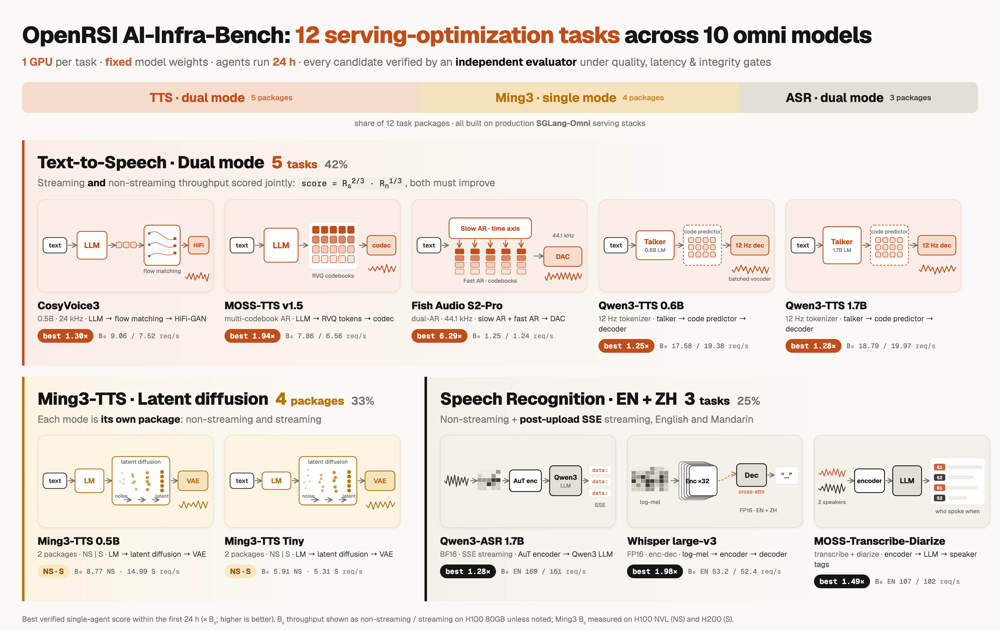

<a id="readme-top"></a>

<p align="center">
  
</p>

<h3 align="center">Can coding agents make real AI infrastructure faster?</h3>

<p align="center">
  <a href="https://index.openrsi.foundation/blog/2026/openrsi-sglang-omni/"></a>&nbsp;
  <a href="https://index.openrsi.foundation/logs/"></a>&nbsp;
  <a href="docs/upstream-results.md"></a>&nbsp;
  <a href="https://x.com/OpenRSI/status/2102831770458890626"></a>
</p>

---

**OpenRSI-AI-Infra-bench** benchmarks **recursive self-improvement (RSI) in real AI serving systems**. Agents iteratively optimize a serving stack with fixed model weights and GPU resources. An independent evaluator verifies speedups under **quality and latency constraints**; each accepted improvement becomes the next baseline.

Developed [jointly by OpenRSI and the SGLang-Omni team](https://index.openrsi.foundation/blog/2026/openrsi-sglang-omni/), the benchmark includes **10 carefully reviewed tasks for omni models**. Each task provides a production serving stack with pinned source code, assets, dependencies and evaluation protocols. The collection is part of the [OpenRSI Index](https://index.openrsi.foundation/).

<a id="leaderboard"></a>

## 🏆 Leaderboard

Best verified **normalized scores (× B₀)** within the first **24 hours**, from **16 unguided single-agent runs across 8 paired tasks**, with [RSI-Harness](https://github.com/OpenRSI-Foundation/OpenRSI-Index/tree/main/RSI-Harness). **1.0× is the initial baseline; higher is better.**

**Codex:** `gpt-6-astra` (xhigh) · **Claude Code:** `claude-opus-5-5` (max).

| Task | Track | Mode | Codex | Claude Code | Raw Archive |
| :--- | :---: | :--- | ---: | ---: | :--- |
| **[CosyVoice3 (0.5B)](tasks/cosyvoice3-dual-mode/)** | 🗣️ TTS | Dual mode | [1.172×](https://huggingface.co/datasets/OpenRSI-Foundation/OpenRSI-Index-Logs/blob/f5deed0f9c9f75ef0f8a5e9514712f8601aea360/sglang-omni/cosyvoice3-dual-mode/codex-gpt-6-astra/submissions/agent-11/report.json) | [**1.297×**](https://huggingface.co/datasets/OpenRSI-Foundation/OpenRSI-Index-Logs/blob/f5deed0f9c9f75ef0f8a5e9514712f8601aea360/sglang-omni/cosyvoice3-dual-mode/claude-code-claude-opus-5-5/submissions/agent-3/report.json) | [HF ↗](https://huggingface.co/datasets/OpenRSI-Foundation/OpenRSI-Index-Logs/tree/main/sglang-omni/cosyvoice3-dual-mode) |
| **[MOSS-TTS v1.5](tasks/moss-tts-v1.5-dual-mode/)** | 🗣️ TTS | Dual mode | [1.339×](https://huggingface.co/datasets/OpenRSI-Foundation/OpenRSI-Index-Logs/blob/f5deed0f9c9f75ef0f8a5e9514712f8601aea360/sglang-omni/moss-tts-v1.5-dual-mode/codex-gpt-6-astra/submissions/agent-8/report.json) | [**1.935×**](https://huggingface.co/datasets/OpenRSI-Foundation/OpenRSI-Index-Logs/blob/f5deed0f9c9f75ef0f8a5e9514712f8601aea360/sglang-omni/moss-tts-v1.5-dual-mode/claude-code-claude-opus-5-5/submissions/agent-4/report.json) | [HF ↗](https://huggingface.co/datasets/OpenRSI-Foundation/OpenRSI-Index-Logs/tree/main/sglang-omni/moss-tts-v1.5-dual-mode) |
| **[Fish Audio S2-Pro](tasks/fish-s2-pro-dual-mode/)** | 🗣️ TTS | Dual mode | [1.739×](https://huggingface.co/datasets/OpenRSI-Foundation/OpenRSI-Index-Logs/blob/f5deed0f9c9f75ef0f8a5e9514712f8601aea360/sglang-omni/fish-s2-pro-dual-mode/codex-gpt-6-astra/submissions/agent-9/report.json) | [**6.288×**](https://huggingface.co/datasets/OpenRSI-Foundation/OpenRSI-Index-Logs/blob/f5deed0f9c9f75ef0f8a5e9514712f8601aea360/sglang-omni/fish-s2-pro-dual-mode/claude-code-claude-opus-5-5/submissions/agent-5/report.json) | [HF ↗](https://huggingface.co/datasets/OpenRSI-Foundation/OpenRSI-Index-Logs/tree/main/sglang-omni/fish-s2-pro-dual-mode) |
| **[Qwen3-TTS Base 0.6B](tasks/qwen3-tts-0.6b-dual-mode/)** | 🗣️ TTS | Dual mode | [1.141×](https://huggingface.co/datasets/OpenRSI-Foundation/OpenRSI-Index-Logs/blob/f5deed0f9c9f75ef0f8a5e9514712f8601aea360/sglang-omni/qwen3-tts-0.6b-dual-mode/codex-gpt-6-astra/submissions/agent-3/report.json) | [**1.252×**](https://huggingface.co/datasets/OpenRSI-Foundation/OpenRSI-Index-Logs/blob/f5deed0f9c9f75ef0f8a5e9514712f8601aea360/sglang-omni/qwen3-tts-0.6b-dual-mode/claude-code-claude-opus-5-5/submissions/agent-5/report.json) | [HF ↗](https://huggingface.co/datasets/OpenRSI-Foundation/OpenRSI-Index-Logs/tree/main/sglang-omni/qwen3-tts-0.6b-dual-mode) |
| **[Qwen3-TTS Base 1.7B](tasks/qwen3-tts-1.7b-dual-mode/)** | 🗣️ TTS | Dual mode | [1.096×](https://huggingface.co/datasets/OpenRSI-Foundation/OpenRSI-Index-Logs/blob/f5deed0f9c9f75ef0f8a5e9514712f8601aea360/sglang-omni/qwen3-tts-1.7b-dual-mode/codex-gpt-6-astra/submissions/agent-10/report.json) | [**1.283×**](https://huggingface.co/datasets/OpenRSI-Foundation/OpenRSI-Index-Logs/blob/f5deed0f9c9f75ef0f8a5e9514712f8601aea360/sglang-omni/qwen3-tts-1.7b-dual-mode/claude-code-claude-opus-5-5/submissions/agent-3/report.json) | [HF ↗](https://huggingface.co/datasets/OpenRSI-Foundation/OpenRSI-Index-Logs/tree/main/sglang-omni/qwen3-tts-1.7b-dual-mode) |
| **[Ming3-TTS 0.5B](tasks/ming3-tts-0.5b-nonstream/)** | 🗣️ TTS | Non-streaming | — | — | [HF ↗](https://huggingface.co/datasets/OpenRSI-Foundation/OpenRSI-Index-Logs/tree/main/sglang-omni/ming3-tts-0.5b-nonstream) |
| **[Ming3-TTS 0.5B](tasks/ming3-tts-0.5b-streaming/)** | 🗣️ TTS | Streaming | — | — | [HF ↗](https://huggingface.co/datasets/OpenRSI-Foundation/OpenRSI-Index-Logs/tree/main/sglang-omni/ming3-tts-0.5b-streaming) |
| **[Ming3-TTS Tiny](tasks/ming3-tts-tiny-nonstream/)** | 🗣️ TTS | Non-streaming | — | — | [HF ↗](https://huggingface.co/datasets/OpenRSI-Foundation/OpenRSI-Index-Logs/tree/main/sglang-omni/ming3-tts-tiny-nonstream) |
| **[Ming3-TTS Tiny](tasks/ming3-tts-tiny-streaming/)** | 🗣️ TTS | Streaming | — | — | [HF ↗](https://huggingface.co/datasets/OpenRSI-Foundation/OpenRSI-Index-Logs/tree/main/sglang-omni/ming3-tts-tiny-streaming) |
| **[Qwen3-ASR 1.7B](tasks/qwen3-asr-1.7b-dual-mode/)** | 👂 ASR | Dual mode | [1.117×](https://huggingface.co/datasets/OpenRSI-Foundation/OpenRSI-Index-Logs/blob/f5deed0f9c9f75ef0f8a5e9514712f8601aea360/sglang-omni/qwen3-asr-1.7b-dual-mode/codex-gpt-6-astra/submissions/agent-47/report.json) | [**1.278×**](https://huggingface.co/datasets/OpenRSI-Foundation/OpenRSI-Index-Logs/blob/f5deed0f9c9f75ef0f8a5e9514712f8601aea360/sglang-omni/qwen3-asr-1.7b-dual-mode/claude-code-claude-opus-5-5/submissions/agent-11/report.json) | [HF ↗](https://huggingface.co/datasets/OpenRSI-Foundation/OpenRSI-Index-Logs/tree/main/sglang-omni/qwen3-asr-1.7b-dual-mode) |
| **[Whisper large-v3](tasks/whisper-large-v3-dual-mode/)** | 👂 ASR | Dual mode | [1.126×](https://huggingface.co/datasets/OpenRSI-Foundation/OpenRSI-Index-Logs/blob/f5deed0f9c9f75ef0f8a5e9514712f8601aea360/sglang-omni/whisper-large-v3-dual-mode/codex-gpt-6-astra/submissions/agent-8/report.json) | [**1.979×**](https://huggingface.co/datasets/OpenRSI-Foundation/OpenRSI-Index-Logs/blob/f5deed0f9c9f75ef0f8a5e9514712f8601aea360/sglang-omni/whisper-large-v3-dual-mode/claude-code-claude-opus-5-5/submissions/agent-12/report.json) | [HF ↗](https://huggingface.co/datasets/OpenRSI-Foundation/OpenRSI-Index-Logs/tree/main/sglang-omni/whisper-large-v3-dual-mode) |
| **[MOSS-Transcribe-Diarize](tasks/moss-transcribe-diarize-dual-mode/)** | 👂 ASR | Dual mode | [1.134×](https://huggingface.co/datasets/OpenRSI-Foundation/OpenRSI-Index-Logs/blob/f5deed0f9c9f75ef0f8a5e9514712f8601aea360/sglang-omni/moss-transcribe-diarize-dual-mode/codex-gpt-6-astra/submissions/agent-19/report.json) | [**1.490×**](https://huggingface.co/datasets/OpenRSI-Foundation/OpenRSI-Index-Logs/blob/f5deed0f9c9f75ef0f8a5e9514712f8601aea360/sglang-omni/moss-transcribe-diarize-dual-mode/claude-code-claude-opus-5-5/submissions/agent-6/report.json) | [HF ↗](https://huggingface.co/datasets/OpenRSI-Foundation/OpenRSI-Index-Logs/tree/main/sglang-omni/moss-transcribe-diarize-dual-mode) |

<sub>— No complete 24-hour result available. Longer runs are truncated at 24 h; shorter runs are excluded. All 21 original trajectories remain in the <a href="results/archive.md">raw archive</a>.</sub>

<details>
<summary><strong>How scores are calculated</strong></summary>

**Run settings.** Each run uses one unguided agent in RSI-Harness: **Codex** with `gpt-6-astra` (`xhigh` reasoning effort), or **Claude Code** with `claude-opus-5-5` (`max`). Both agents are compared over the same **first 24 hours**, with fixed model weights and **one H100 80GB HBM3 GPU** for the currently paired tasks. Longer runs are truncated at 24 h; shorter runs are excluded. Paired runs use the same task instructions, base image and evaluation protocol, with an initial B₀ calibrated separately for each run. See the [24-hour results and cutoff details](results/README.md) and the [reproduction guide](docs/running.md).

Each entry is the highest verified score recorded within the first 24 hours of a run. For each mode, divide the candidate's mean QPS by that run's fixed initial baseline's mean QPS; each mean uses three repetitions.

- **Single mode:** the score is that mode's QPS ratio to B₀.
- **Dual mode:** $\mathrm{score} = R_s^{2/3} R_n^{1/3}$, where $R_s$ and $R_n$ are the streaming and non-streaming QPS ratios. Streaming has weight ⅔; non-streaming has weight ⅓.
- **ASR:** each mode's ratio is first the geometric mean of its English and Mandarin QPS ratios: $R_m = \sqrt{R_{m,\mathrm{en}} R_{m,\mathrm{zh}}}$.

For example, **2.0× streaming** and **1.5× non-streaming** yield a **1.817× normalized score**. Only submissions passing the task's quality, latency, streaming and integrity gates qualify; dual-mode submissions must improve both modes over B₀.

</details>

<a id="news"></a>

## 📰 News

- **[2026-11]** 🚀 **Refined Harbor 1.4 benchmark & 21 trajectories released** — All 12 SGLang-Omni tasks now run natively via `rsi-harness run` out of the box (`-89.6%` repository footprint, hardened clean-image Judge gates) alongside **21 uncompressed single-agent trajectories** on [Hugging Face](https://huggingface.co/datasets/OpenRSI-Foundation/OpenRSI-Index-Logs/tree/main/sglang-omni) and the [RSI Logs Viewer](https://index.openrsi.foundation/logs/).
- **[2026-11]** 🎤 Presented **Scaling RSI for AI Infra** at [SGLang Summit 2026](https://www.sglang.io/summit) · [[Slides]](https://docs.google.com/presentation/d/1ODcBjqT9sl0NRa7SdtV4rwULmMZI71xx/edit).
- **[2026-11]** 📝 Blog: **[OpenRSI × SGLang-Omni: Scaling RSI for AI Infra](https://index.openrsi.foundation/blog/2026/openrsi-sglang-omni/)** — Agent-discovered optimizations raised H100 throughput by **+7.6% to +326.5%** across eight omni model families, with **14 PRs** reviewed and merged upstream.

<a id="highlights"></a>

## ✨ Highlights

<table>
  <tr>
    <td align="center" width="20%"><h3>10</h3><strong>Omni models</strong><br><sub>TTS &amp; ASR</sub></td>
    <td align="center" width="20%"><h3>10</h3><strong>Reviewed tasks</strong><br><sub>Production workloads</sub></td>
    <td align="center" width="20%"><h3>6.29×</h3><strong>Peak verified score</strong><br><sub>1.0× initial baseline</sub></td>
    <td align="center" width="20%"><h3>14</h3><strong>Merged PRs</strong><br><sub>SGLang-Omni upstream</sub></td>
    <td align="center" width="20%"><h3>1 GPU</h3><strong>Per task</strong><br><sub>Fixed GPU resources</sub></td>
  </tr>
</table>

- **Built with maintainers.** Production serving tasks jointly designed and reviewed by OpenRSI and SGLang-Omni, with pinned source code, assets, and dependencies.
- **Verified under constraints.** An independent evaluator checks performance alongside quality, latency, and integrity before accepting a score. [Evaluation protocol →](docs/evaluation.md)
- **Improvements that ship.** The collaboration has produced 14 PRs reviewed and merged by SGLang-Omni maintainers. [Upstream results →](docs/upstream-results.md)
- **Every round inspectable.** Explore agent actions and evaluator feedback across 21 public single-agent trajectories, or run a task yourself on one GPU. [Browse runs →](https://index.openrsi.foundation/logs/)

Agents iterate on the serving runtime; an isolated evaluator measures each submitted candidate. [How it works →](docs/how-it-works.md)

<a id="tasks"></a>

## 📦 Tasks

<p align="center">
  
</p>

Technical specification across all **12 benchmark packages** (best verified single-agent score within the first 24 hours vs. that run's B₀, paired with detailed 3-repetition mean B₀ throughput from `tests/baseline.json`; `NS` = non-streaming, `S` = streaming):

| Package | Model Checkpoint | `sglang-omni` Base | Best 24h Score | Reference B₀ Throughput (`req/s`) |
| :--- | :--- | :---: | ---: | :--- |
| [`cosyvoice3-dual-mode`](tasks/cosyvoice3-dual-mode/) | [`Fun-CosyVoice3-0.5B-2512`](https://huggingface.co/FunAudioLLM/Fun-CosyVoice3-0.5B-2512) | [`15235430`](https://github.com/sgl-project/sglang-omni/tree/1523543056bf334bc2f4d69db23aad0a002cedf2) | [**1.297×**](https://huggingface.co/datasets/OpenRSI-Foundation/OpenRSI-Index-Logs/blob/f5deed0f9c9f75ef0f8a5e9514712f8601aea360/sglang-omni/cosyvoice3-dual-mode/claude-code-claude-opus-5-5/submissions/agent-3/report.json) | Non-streaming `9.06` · Streaming `7.52` <sub>(H100 80GB HBM3)</sub> |
| [`moss-tts-v1.5-dual-mode`](tasks/moss-tts-v1.5-dual-mode/) | [`MOSS-TTS-v1.5`](https://huggingface.co/OpenMOSS-Team/MOSS-TTS-v1.5) | [`cb75ab40`](https://github.com/sgl-project/sglang-omni/tree/cb75ab409669a6ab672fa42421b41b11af2fe263) | [**1.935×**](https://huggingface.co/datasets/OpenRSI-Foundation/OpenRSI-Index-Logs/blob/f5deed0f9c9f75ef0f8a5e9514712f8601aea360/sglang-omni/moss-tts-v1.5-dual-mode/claude-code-claude-opus-5-5/submissions/agent-4/report.json) | Non-streaming `7.86` · Streaming `6.56` <sub>(H100 80GB HBM3)</sub> |
| [`fish-s2-pro-dual-mode`](tasks/fish-s2-pro-dual-mode/) | [`fishaudio/s2-pro`](https://huggingface.co/fishaudio/s2-pro) | [`15235430`](https://github.com/sgl-project/sglang-omni/tree/1523543056bf334bc2f4d69db23aad0a002cedf2) | [**6.288×**](https://huggingface.co/datasets/OpenRSI-Foundation/OpenRSI-Index-Logs/blob/f5deed0f9c9f75ef0f8a5e9514712f8601aea360/sglang-omni/fish-s2-pro-dual-mode/claude-code-claude-opus-5-5/submissions/agent-5/report.json) | Non-streaming `1.25` · Streaming `1.24` <sub>(H100 80GB HBM3)</sub> |
| [`qwen3-tts-0.6b-dual-mode`](tasks/qwen3-tts-0.6b-dual-mode/) | [`Qwen3-TTS-12Hz-0.6B-Base`](https://huggingface.co/Qwen/Qwen3-TTS-12Hz-0.6B-Base) | [`15235430`](https://github.com/sgl-project/sglang-omni/tree/1523543056bf334bc2f4d69db23aad0a002cedf2) | [**1.252×**](https://huggingface.co/datasets/OpenRSI-Foundation/OpenRSI-Index-Logs/blob/f5deed0f9c9f75ef0f8a5e9514712f8601aea360/sglang-omni/qwen3-tts-0.6b-dual-mode/claude-code-claude-opus-5-5/submissions/agent-5/report.json) | Non-streaming `17.58` · Streaming `19.38` <sub>(H100 80GB HBM3)</sub> |
| [`qwen3-tts-1.7b-dual-mode`](tasks/qwen3-tts-1.7b-dual-mode/) | [`Qwen3-TTS-12Hz-1.7B-Base`](https://huggingface.co/Qwen/Qwen3-TTS-12Hz-1.7B-Base) | [`15235430`](https://github.com/sgl-project/sglang-omni/tree/1523543056bf334bc2f4d69db23aad0a002cedf2) | [**1.283×**](https://huggingface.co/datasets/OpenRSI-Foundation/OpenRSI-Index-Logs/blob/f5deed0f9c9f75ef0f8a5e9514712f8601aea360/sglang-omni/qwen3-tts-1.7b-dual-mode/claude-code-claude-opus-5-5/submissions/agent-3/report.json) | Non-streaming `18.79` · Streaming `19.97` <sub>(H100 80GB HBM3)</sub> |
| [`ming3-tts-0.5b-nonstream`](tasks/ming3-tts-0.5b-nonstream/) | [`Ming-3.0-tts-0.5B`](https://huggingface.co/inclusionAI/Ming-3.0-tts-0.5B) | [`ca9e8789`](https://github.com/sgl-project/sglang-omni/tree/ca9e8789fcd84ed6f7272276cb99447eec751787) | — | Non-streaming `8.77` <sub>(H100 NVL)</sub> |
| [`ming3-tts-0.5b-streaming`](tasks/ming3-tts-0.5b-streaming/) | [`Ming-3.0-tts-0.5B`](https://huggingface.co/inclusionAI/Ming-3.0-tts-0.5B) | [`0c663861`](https://github.com/sgl-project/sglang-omni/tree/0c663861d7d4a558e4f53258c4d48cfce577b47e) | — | Streaming `14.99` <sub>(H200)</sub> |
| [`ming3-tts-tiny-nonstream`](tasks/ming3-tts-tiny-nonstream/) | [`Ming-3.0-tts-tiny`](https://huggingface.co/inclusionAI/Ming-3.0-tts-tiny) | [`ca9e8789`](https://github.com/sgl-project/sglang-omni/tree/ca9e8789fcd84ed6f7272276cb99447eec751787) | — | Non-streaming `5.91` <sub>(H100 NVL)</sub> |
| [`ming3-tts-tiny-streaming`](tasks/ming3-tts-tiny-streaming/) | [`Ming-3.0-tts-tiny`](https://huggingface.co/inclusionAI/Ming-3.0-tts-tiny) | [`0c663861`](https://github.com/sgl-project/sglang-omni/tree/0c663861d7d4a558e4f53258c4d48cfce577b47e) | — | Streaming `5.31` <sub>(H200)</sub> |
| [`qwen3-asr-1.7b-dual-mode`](tasks/qwen3-asr-1.7b-dual-mode/) | [`Qwen3-ASR-1.7B`](https://huggingface.co/Qwen/Qwen3-ASR-1.7B) | [`eb7e97ed`](https://github.com/sgl-project/sglang-omni/tree/eb7e97ed9438ef4e4352656aec6170aeeb90966f) | [**1.278×**](https://huggingface.co/datasets/OpenRSI-Foundation/OpenRSI-Index-Logs/blob/f5deed0f9c9f75ef0f8a5e9514712f8601aea360/sglang-omni/qwen3-asr-1.7b-dual-mode/claude-code-claude-opus-5-5/submissions/agent-11/report.json) | EN `168.92` NS / `160.60` S · ZH `179.78` NS / `172.06` S <sub>(H100 80GB HBM3)</sub> |
| [`whisper-large-v3-dual-mode`](tasks/whisper-large-v3-dual-mode/) | [`openai/whisper-large-v3`](https://huggingface.co/openai/whisper-large-v3) | [`eb7e97ed`](https://github.com/sgl-project/sglang-omni/tree/eb7e97ed9438ef4e4352656aec6170aeeb90966f) | [**1.979×**](https://huggingface.co/datasets/OpenRSI-Foundation/OpenRSI-Index-Logs/blob/f5deed0f9c9f75ef0f8a5e9514712f8601aea360/sglang-omni/whisper-large-v3-dual-mode/claude-code-claude-opus-5-5/submissions/agent-12/report.json) | EN `53.21` NS / `52.43` S · ZH `48.62` NS / `48.57` S <sub>(H100 80GB HBM3)</sub> |
| [`moss-transcribe-diarize-dual-mode`](tasks/moss-transcribe-diarize-dual-mode/) | [`MOSS-Transcribe-Diarize`](https://huggingface.co/OpenMOSS-Team/MOSS-Transcribe-Diarize) | [`8220d220`](https://github.com/sgl-project/sglang-omni/tree/8220d220703cf8d8f5c5d9a2cde00b5ed13717b8) | [**1.490×**](https://huggingface.co/datasets/OpenRSI-Foundation/OpenRSI-Index-Logs/blob/f5deed0f9c9f75ef0f8a5e9514712f8601aea360/sglang-omni/moss-transcribe-diarize-dual-mode/claude-code-claude-opus-5-5/submissions/agent-6/report.json) | EN `106.81` NS / `102.15` S · ZH `109.60` NS / `105.50` S <sub>(H100 80GB HBM3)</sub> |

<a id="quick-start"></a>

## 🚀 Quick start

### 1. Clone and verify task integrity

Clone this repository directly—or pull it via the `rsi-tasks/sglang-omni` submodule inside `OpenRSI-Index`:

```bash
# Option A: standalone repository
git clone https://github.com/OpenRSI-Foundation/OpenRSI-AI-Infra-Bench.git
cd OpenRSI-AI-Infra-Bench

# Option B: via OpenRSI-Index
git clone --recurse-submodules https://github.com/OpenRSI-Foundation/OpenRSI-Index.git
cd OpenRSI-Index/rsi-tasks/sglang-omni

# Verify all 12 task manifests, SHA-256 hashes, and Python/JSON/TOML/shell syntax (CPU-only)
python3 -B scripts/verify.py
```

Expected output:

```text
PASS: 12 task packages; 320 files match the source snapshot.
Checked hashes, executable modes, and Python/JSON/TOML/shell syntax. No GPU evaluation performed.
```

### 2. Install RSI-Harness and validate with `--agent oracle`

**Requirements:** Linux, Docker Engine 26+, NVIDIA Container Toolkit, Python 3.12, 1 GPU (80 GB+ VRAM recommended), 16 idle physical CPU cores, 128 GiB RAM, and ~200 GiB free SSD storage.

Install [RSI-Harness](https://github.com/OpenRSI-Foundation/OpenRSI-Index/tree/main/RSI-Harness), then run `--agent oracle` on any TTS or ASR task to verify Docker image build, NUMA core pinning, and full 3-repetition Judge evaluation (`reward = 1.0`):

```bash
rsi-harness run tasks/cosyvoice3-dual-mode --agent oracle --gpus 0
rsi-harness run tasks/qwen3-asr-1.7b-dual-mode --agent oracle --gpus 0
```

<details>
<summary><strong>Expected clean-image Judge verification output (<code>reward = 1.0</code>)</strong></summary>

```text
[judge] Pinned 16 idle physical CPU cores on GPU 0 NUMA node 0 (peak_foreign_cores <= 2.0)
[judge] Unmodified baseline source detected -> running 3x verification repeats per mode
[judge] Non-streaming mean throughput : R_n = 1.000x  (WER <= 2.0%, P95 <= 1.03x B0)
[judge] Streaming mean throughput     : R_s = 1.000x  (multi-chunk >= 95%, c50 >= 95%)
[judge] All quality, latency, streaming, and cleanup gates PASSED -> /logs/verifier/reward.txt = 1.0
```

</details>

### 3. Run a coding agent

All 12 TTS and ASR tasks share the exact same `rsi-harness run` interface:

```bash
TASK_DIR="$PWD/tasks/cosyvoice3-dual-mode"

# Codex
rsi-harness run "$TASK_DIR" \
  --agent codex --model gpt-6-astra --reasoning-effort xhigh \
  --agent-auth local --gpus 0

# Claude Code
rsi-harness run "$TASK_DIR" \
  --agent claude-code --model claude-opus-5-5 --reasoning-effort max \
  --agent-auth local --gpus 0
```

> [!TIP]
> **Custom GPU SKUs (`RSI_BASELINE_JSON`):** Each task bakes reference B₀ metrics into `tests/baseline.json`. When running optimization loops on a different GPU SKU (e.g., PCIe H100 NVL vs. SXM5 H100, or A100/B200), measure a fresh 3-repetition B₀ once with `/opt/sglang/bin/python3 -I -B /tests/calibrate.py` and export `RSI_BASELINE_JSON`—see [docs/running.md](docs/running.md#4-optional-recalibrating-reference-b_0-for-custom-gpu-skus).

### 4. Inspect local runs or download the 21 baseline trajectories

```bash
# Visualize local RSI-Harness runs at http://127.0.0.1:8000
rsi-harness visualize

# Download one task's published trajectories (or omit --include for all 21 runs)
hf download OpenRSI-Foundation/OpenRSI-Index-Logs --repo-type dataset \
  --include "sglang-omni/cosyvoice3-dual-mode/*" --local-dir OpenRSI-Index-Logs
```

📖 **[Full setup, GPU calibration and execution guide →](docs/running.md)**

<a id="contributors"></a>

## 🤝 Core Contributors

<table>
  <tr>
    <td align="center" width="33%"><a href="https://zhuofeng-li.github.io/"><strong>Zhuofeng Li</strong></a></td>
    <td align="center" width="33%"><a href="https://github.com/db-ol"><strong>Aaron Tian</strong></a></td>
    <td align="center" width="33%"><a href="https://github.com/zhaochenyang20"><strong>Chenyang Zhao</strong></a></td>
  </tr>
  <tr>
    <td align="center" width="33%"><a href="https://yichenfeng.me/"><strong>Yichen Feng</strong></a></td>
    <td align="center" width="33%"><a href="https://wenhaochai.com/"><strong>Wenhao Chai</strong></a></td>
    <td align="center" width="33%"><a href="https://weikangda.github.io/kangda.github.io/"><strong>Kangda Wei</strong></a></td>
  </tr>
  <tr>
    <td align="center" width="33%"><a href="https://davidhanx.github.io/"><strong>Xinyang Han</strong></a></td>
    <td align="center" width="33%"><a href="https://caralinotes.com/"><strong>Cara Li</strong></a></td>
    <td align="center" width="33%"><a href="https://vincentcaptain.github.io/"><strong>Shujia Liang</strong></a></td>
  </tr>
  <tr>
    <td align="center" colspan="3"><a href="https://yuetl9.github.io/"><strong>Yuetai Li</strong></a></td>
  </tr>
</table>

We thank the **[SGLang-Omni](https://github.com/sgl-project/sglang-omni)** maintainers and contributors for many rounds of code review, design guidance, and independent benchmark reproductions. Interested in building new AI infrastructure RSI benchmarks? See the **[OpenRSI Call for Contributors](https://github.com/OpenRSI-Foundation/OpenRSI-Index#-call-for-contributors)**.

<a id="citation"></a>

## 📖 Citation

If you find OpenRSI-AI-Infra-Bench useful in your research or engineering, please cite:

```bibtex
@misc{li2026openrsisglangomni,
  title  = {{OpenRSI} $\times$ {SGLang-Omni}: Scaling {RSI} for {AI} Infra},
  author = {Li, Zhuofeng and Tian, Aaron and Feng, Yichen and Chai, Wenhao and
            Han, Xinyang and Li, Cara and Liang, Shujia and Li, Yuetai and
            Zhao, Chenyang},
  year   = {2026},
  month  = nov,
  url    = {https://index.openrsi.foundation/blog/2026/openrsi-sglang-omni/}
}
```

<p align="right"><a href="#readme-top">↑ Back to top</a></p>

---

<p align="center">
  Built by the <a href="https://github.com/OpenRSI-Foundation"><b>OpenRSI Foundation</b></a>
  with the <a href="https://github.com/sgl-project/sglang-omni"><b>SGLang-Omni</b></a> community.
</p>
