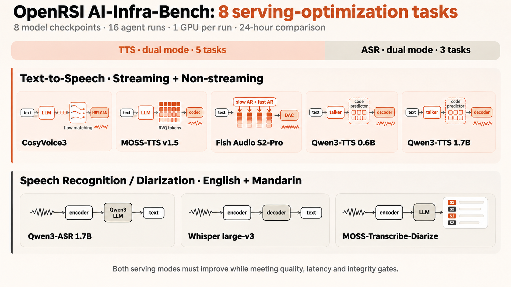

<a id="readme-top"></a>

<p align="center">
  
</p>

<h3 align="center">Can coding agents make real AI infrastructure faster?</h3>

<p align="center">
  <a href="https://index.openrsi.foundation/blog/2026/openrsi-sglang-omni/"></a>&nbsp;
  <a href="results/archive.md"></a>&nbsp;
  <a href="docs/upstream-results.md"></a>&nbsp;
  <a href="https://x.com/OpenRSI/status/2102831770458890626"></a>
</p>

---

**OpenRSI-AI-Infra-Bench** evaluates whether coding agents can improve real AI serving systems. Agents profile and modify [SGLang-Omni](https://github.com/sgl-project/sglang-omni) under fixed model weights and GPU resources. An isolated evaluator measures throughput against each run's **fixed initial baseline B₀**, subject to quality, latency, and streaming constraints.

Built [jointly with the SGLang-Omni team](https://index.openrsi.foundation/blog/2026/openrsi-sglang-omni/), the suite contains **8 tasks: 5 text-to-speech and 3 speech recognition / diarization tasks**. Every task evaluates both streaming and non-streaming serving and ships with pinned source, dependencies, model assets, and evaluation code. This is the AI infrastructure track of the [OpenRSI Index](https://index.openrsi.foundation/).

<a id="highlights"></a>

## ✨ Highlights

- **Built with SGLang-Omni maintainers.** OpenRSI and the maintainers designed the tasks around production serving workloads. Optimizations that agents found for these models contributed to **11 PRs** the maintainers merged upstream. [Upstream results →](docs/upstream-results.md)
- **16 public agent trajectories.** Follow each run round by round to see what the agent changed, how the evaluator scored it, and what the agent tried next. [Browse runs →](results/archive.md)
- **Hill-climbing RSI on a single GPU.** One 80 GB H100 per task is enough to test whether an agent can improve serving throughput by building on its best result from earlier rounds. [Running guide →](docs/running.md)

<a id="leaderboard"></a>

## 🏆 Leaderboard

Best verified score within the **first 24 hours** of each unguided single-agent run. **1.0× is the initial baseline; higher is better.** All runs use one H100 80GB HBM3 GPU.

**Codex:** `gpt-6-astra` · `xhigh` reasoning. **Claude Code:** `claude-opus-5-5` · `max` reasoning.

| Task | Track | Codex | Claude Code | Trajectories |
| :--- | :---: | ---: | ---: | :--- |
| **[CosyVoice3 (0.5B)](tasks/cosyvoice3-dual-mode/)** | 🗣️ TTS | [1.172×](https://huggingface.co/datasets/OpenRSI-Foundation/OpenRSI-Index-Logs/blob/f5deed0f9c9f75ef0f8a5e9514712f8601aea360/sglang-omni/cosyvoice3-dual-mode/codex-gpt-6-astra/submissions/agent-11/report.json) | [**1.297×**](https://huggingface.co/datasets/OpenRSI-Foundation/OpenRSI-Index-Logs/blob/f5deed0f9c9f75ef0f8a5e9514712f8601aea360/sglang-omni/cosyvoice3-dual-mode/claude-code-claude-opus-5-5/submissions/agent-3/report.json) | [HF ↗](https://huggingface.co/datasets/OpenRSI-Foundation/OpenRSI-Index-Logs/tree/main/sglang-omni/cosyvoice3-dual-mode) |
| **[MOSS-TTS v1.5](tasks/moss-tts-v1.5-dual-mode/)** | 🗣️ TTS | [1.339×](https://huggingface.co/datasets/OpenRSI-Foundation/OpenRSI-Index-Logs/blob/f5deed0f9c9f75ef0f8a5e9514712f8601aea360/sglang-omni/moss-tts-v1.5-dual-mode/codex-gpt-6-astra/submissions/agent-8/report.json) | [**1.935×**](https://huggingface.co/datasets/OpenRSI-Foundation/OpenRSI-Index-Logs/blob/f5deed0f9c9f75ef0f8a5e9514712f8601aea360/sglang-omni/moss-tts-v1.5-dual-mode/claude-code-claude-opus-5-5/submissions/agent-4/report.json) | [HF ↗](https://huggingface.co/datasets/OpenRSI-Foundation/OpenRSI-Index-Logs/tree/main/sglang-omni/moss-tts-v1.5-dual-mode) |
| **[Fish Audio S2-Pro](tasks/fish-s2-pro-dual-mode/)** | 🗣️ TTS | [1.739×](https://huggingface.co/datasets/OpenRSI-Foundation/OpenRSI-Index-Logs/blob/f5deed0f9c9f75ef0f8a5e9514712f8601aea360/sglang-omni/fish-s2-pro-dual-mode/codex-gpt-6-astra/submissions/agent-9/report.json) | [**6.288×**](https://huggingface.co/datasets/OpenRSI-Foundation/OpenRSI-Index-Logs/blob/f5deed0f9c9f75ef0f8a5e9514712f8601aea360/sglang-omni/fish-s2-pro-dual-mode/claude-code-claude-opus-5-5/submissions/agent-5/report.json) | [HF ↗](https://huggingface.co/datasets/OpenRSI-Foundation/OpenRSI-Index-Logs/tree/main/sglang-omni/fish-s2-pro-dual-mode) |
| **[Qwen3-TTS Base 0.6B](tasks/qwen3-tts-0.6b-dual-mode/)** | 🗣️ TTS | [1.141×](https://huggingface.co/datasets/OpenRSI-Foundation/OpenRSI-Index-Logs/blob/f5deed0f9c9f75ef0f8a5e9514712f8601aea360/sglang-omni/qwen3-tts-0.6b-dual-mode/codex-gpt-6-astra/submissions/agent-3/report.json) | [**1.252×**](https://huggingface.co/datasets/OpenRSI-Foundation/OpenRSI-Index-Logs/blob/f5deed0f9c9f75ef0f8a5e9514712f8601aea360/sglang-omni/qwen3-tts-0.6b-dual-mode/claude-code-claude-opus-5-5/submissions/agent-5/report.json) | [HF ↗](https://huggingface.co/datasets/OpenRSI-Foundation/OpenRSI-Index-Logs/tree/main/sglang-omni/qwen3-tts-0.6b-dual-mode) |
| **[Qwen3-TTS Base 1.7B](tasks/qwen3-tts-1.7b-dual-mode/)** | 🗣️ TTS | [1.096×](https://huggingface.co/datasets/OpenRSI-Foundation/OpenRSI-Index-Logs/blob/f5deed0f9c9f75ef0f8a5e9514712f8601aea360/sglang-omni/qwen3-tts-1.7b-dual-mode/codex-gpt-6-astra/submissions/agent-10/report.json) | [**1.283×**](https://huggingface.co/datasets/OpenRSI-Foundation/OpenRSI-Index-Logs/blob/f5deed0f9c9f75ef0f8a5e9514712f8601aea360/sglang-omni/qwen3-tts-1.7b-dual-mode/claude-code-claude-opus-5-5/submissions/agent-3/report.json) | [HF ↗](https://huggingface.co/datasets/OpenRSI-Foundation/OpenRSI-Index-Logs/tree/main/sglang-omni/qwen3-tts-1.7b-dual-mode) |
| **[Qwen3-ASR 1.7B](tasks/qwen3-asr-1.7b-dual-mode/)** | 👂 ASR | [1.117×](https://huggingface.co/datasets/OpenRSI-Foundation/OpenRSI-Index-Logs/blob/f5deed0f9c9f75ef0f8a5e9514712f8601aea360/sglang-omni/qwen3-asr-1.7b-dual-mode/codex-gpt-6-astra/submissions/agent-47/report.json) | [**1.278×**](https://huggingface.co/datasets/OpenRSI-Foundation/OpenRSI-Index-Logs/blob/f5deed0f9c9f75ef0f8a5e9514712f8601aea360/sglang-omni/qwen3-asr-1.7b-dual-mode/claude-code-claude-opus-5-5/submissions/agent-11/report.json) | [HF ↗](https://huggingface.co/datasets/OpenRSI-Foundation/OpenRSI-Index-Logs/tree/main/sglang-omni/qwen3-asr-1.7b-dual-mode) |
| **[Whisper large-v3](tasks/whisper-large-v3-dual-mode/)** | 👂 ASR | [1.126×](https://huggingface.co/datasets/OpenRSI-Foundation/OpenRSI-Index-Logs/blob/f5deed0f9c9f75ef0f8a5e9514712f8601aea360/sglang-omni/whisper-large-v3-dual-mode/codex-gpt-6-astra/submissions/agent-8/report.json) | [**1.979×**](https://huggingface.co/datasets/OpenRSI-Foundation/OpenRSI-Index-Logs/blob/f5deed0f9c9f75ef0f8a5e9514712f8601aea360/sglang-omni/whisper-large-v3-dual-mode/claude-code-claude-opus-5-5/submissions/agent-12/report.json) | [HF ↗](https://huggingface.co/datasets/OpenRSI-Foundation/OpenRSI-Index-Logs/tree/main/sglang-omni/whisper-large-v3-dual-mode) |
| **[MOSS-Transcribe-Diarize](tasks/moss-transcribe-diarize-dual-mode/)** | 👂 ASR | [1.134×](https://huggingface.co/datasets/OpenRSI-Foundation/OpenRSI-Index-Logs/blob/f5deed0f9c9f75ef0f8a5e9514712f8601aea360/sglang-omni/moss-transcribe-diarize-dual-mode/codex-gpt-6-astra/submissions/agent-19/report.json) | [**1.490×**](https://huggingface.co/datasets/OpenRSI-Foundation/OpenRSI-Index-Logs/blob/f5deed0f9c9f75ef0f8a5e9514712f8601aea360/sglang-omni/moss-transcribe-diarize-dual-mode/claude-code-claude-opus-5-5/submissions/agent-6/report.json) | [HF ↗](https://huggingface.co/datasets/OpenRSI-Foundation/OpenRSI-Index-Logs/tree/main/sglang-omni/moss-transcribe-diarize-dual-mode) |

Scores link to the exact evaluation reports selected by the 24-hour cutoff. Full trajectories may contain later results. [Results and comparison limits](results/README.md) · [JSON](results/main.json) · [CSV](results/runs.csv)

<details>
<summary><strong>Scoring and comparison protocol</strong></summary>

For each mode, divide the candidate's mean throughput by that run's initial B₀ throughput; each mean uses three repetitions. The combined score is:

$$
\mathrm{score} = R_s^{2/3} R_n^{1/3}
$$

Here, $R_s$ and $R_n$ are the streaming and non-streaming ratios. For ASR, each mode's ratio is the geometric mean of its English and Mandarin ratios. Modified candidates must improve both modes and pass every quality, latency, streaming, and integrity gate.

Both agents are evaluated over the same first 24 hours. Each run keeps its own initial B₀ calibration. The [cutoff audit](results/README.md#evidence-and-limits) records hardware, protocol, and source-snapshot comparisons; the [evaluation guide](docs/evaluation.md) describes the gates.

</details>

<a id="tasks"></a>

## 📦 Tasks

<p align="center">
  
</p>

**8 model checkpoints across 7 model families**, all evaluated in streaming and non-streaming modes. Each task link includes its workload, reference throughput, and GPU calibration instructions.

| Task package | Model checkpoint | SGLang-Omni base commit |
| :--- | :--- | :--- |
| [`cosyvoice3-dual-mode`](tasks/cosyvoice3-dual-mode/) | [`Fun-CosyVoice3-0.5B-2512`](https://huggingface.co/FunAudioLLM/Fun-CosyVoice3-0.5B-2512) | [`15235430`](https://github.com/sgl-project/sglang-omni/tree/1523543056bf334bc2f4d69db23aad0a002cedf2) |
| [`moss-tts-v1.5-dual-mode`](tasks/moss-tts-v1.5-dual-mode/) | [`MOSS-TTS-v1.5`](https://huggingface.co/OpenMOSS-Team/MOSS-TTS-v1.5) | [`cb75ab40`](https://github.com/sgl-project/sglang-omni/tree/cb75ab409669a6ab672fa42421b41b11af2fe263) |
| [`fish-s2-pro-dual-mode`](tasks/fish-s2-pro-dual-mode/) | [`fishaudio/s2-pro`](https://huggingface.co/fishaudio/s2-pro) | [`15235430`](https://github.com/sgl-project/sglang-omni/tree/1523543056bf334bc2f4d69db23aad0a002cedf2) |
| [`qwen3-tts-0.6b-dual-mode`](tasks/qwen3-tts-0.6b-dual-mode/) | [`Qwen3-TTS-12Hz-0.6B-Base`](https://huggingface.co/Qwen/Qwen3-TTS-12Hz-0.6B-Base) | [`15235430`](https://github.com/sgl-project/sglang-omni/tree/1523543056bf334bc2f4d69db23aad0a002cedf2) |
| [`qwen3-tts-1.7b-dual-mode`](tasks/qwen3-tts-1.7b-dual-mode/) | [`Qwen3-TTS-12Hz-1.7B-Base`](https://huggingface.co/Qwen/Qwen3-TTS-12Hz-1.7B-Base) | [`15235430`](https://github.com/sgl-project/sglang-omni/tree/1523543056bf334bc2f4d69db23aad0a002cedf2) |
| [`qwen3-asr-1.7b-dual-mode`](tasks/qwen3-asr-1.7b-dual-mode/) | [`Qwen3-ASR-1.7B`](https://huggingface.co/Qwen/Qwen3-ASR-1.7B) | [`eb7e97ed`](https://github.com/sgl-project/sglang-omni/tree/eb7e97ed9438ef4e4352656aec6170aeeb90966f) |
| [`whisper-large-v3-dual-mode`](tasks/whisper-large-v3-dual-mode/) | [`openai/whisper-large-v3`](https://huggingface.co/openai/whisper-large-v3) | [`eb7e97ed`](https://github.com/sgl-project/sglang-omni/tree/eb7e97ed9438ef4e4352656aec6170aeeb90966f) |
| [`moss-transcribe-diarize-dual-mode`](tasks/moss-transcribe-diarize-dual-mode/) | [`MOSS-Transcribe-Diarize`](https://huggingface.co/OpenMOSS-Team/MOSS-Transcribe-Diarize) | [`8220d220`](https://github.com/sgl-project/sglang-omni/tree/8220d220703cf8d8f5c5d9a2cde00b5ed13717b8) |

Each directory is a standalone Harbor 1.4 package, runnable with `rsi-harness run`. See the [task catalog](tasks/README.md) and [package layout](docs/how-it-works.md).

<a id="quick-start"></a>

## 🚀 Quick start

**Requires:** Linux, Docker Engine 26+ with daemon access, NVIDIA drivers + Container Toolkit, Git, and [uv](https://docs.astral.sh/uv/getting-started/installation/). Use one NVIDIA GPU (80 GB+ VRAM recommended); see [full hardware requirements](docs/running.md#1-host-requirements--integrity-check).

Copy and run to set up RSI-Harness and validate CosyVoice3 on GPU 0. No model API key is needed:

```bash
git clone --depth 1 https://github.com/OpenRSI-Foundation/OpenRSI-AI-Infra-Bench.git &&
cd OpenRSI-AI-Infra-Bench &&
git clone --depth 1 --filter=blob:none --sparse \
  https://github.com/OpenRSI-Foundation/OpenRSI-Index.git vendor/OpenRSI-Index &&
git -C vendor/OpenRSI-Index sparse-checkout set RSI-Harness &&
uvx --python 3.12 --from ./vendor/OpenRSI-Index/RSI-Harness \
  rsi-harness run tasks/cosyvoice3-dual-mode --agent oracle --gpus 0
```

The first run installs the Harness, builds the task image, and downloads model weights. Expected result: **`reward = 1.0`**, with artifacts under `logs/runs/<run-id>/`.

To run another benchmark, replace `cosyvoice3-dual-mode` with any [task slug](#tasks). See the [full guide](docs/running.md) for Codex / Claude Code runs, GPU calibration, and result inspection, or [browse the 16 benchmark runs](results/archive.md).

<a id="how-it-works"></a>

<details>
<summary><strong>⚙️ How it works</strong></summary>

1. **Optimize.** A coding agent profiles and edits the serving runtime in a persistent container, with fixed model weights and one GPU.
2. **Evaluate.** Each submitted candidate is tested in a fresh Judge container against the fixed initial B₀, using three repetitions per mode.
3. **Iterate.** The agent uses the evaluator's feedback to improve its next submission. The leaderboard reports the highest valid score within 24 hours.

[RSI-Harness architecture](docs/how-it-works.md) · [Quality and latency gates](docs/evaluation.md) · [Run your own agent](docs/running.md)

</details>

<a id="news"></a>

## 📰 News

- **2026-11:** Released runnable task packages and public agent trajectories. [Browse the results](results/README.md).
- **2026-11:** Presented *Scaling RSI for AI Infra* at [SGLang Summit](https://www.sglang.io/summit). [Slides](https://docs.google.com/presentation/d/1ODcBjqT9sl0NRa7SdtV4rwULmMZI71xx/edit).
- **2026-11:** Published [OpenRSI × SGLang-Omni: Scaling RSI for AI Infra](https://index.openrsi.foundation/blog/2026/openrsi-sglang-omni/).

<a id="contributors"></a>

## 🤝 Core Contributors

<table>
  <tr>
    <td align="center" width="20%"><a href="https://zhuofeng-li.github.io/"><strong>Zhuofeng Li</strong></a></td>
    <td align="center" width="20%"><a href="https://github.com/db-ol"><strong>Aaron Tian</strong></a></td>
    <td align="center" width="20%"><a href="https://yichenfeng.me/"><strong>Yichen Feng</strong></a></td>
    <td align="center" width="20%"><a href="https://wenhaochai.com/"><strong>Wenhao Chai</strong></a></td>
    <td align="center" width="20%"><a href="https://weikangda.github.io/kangda.github.io/"><strong>Kangda Wei</strong></a></td>
  </tr>
  <tr>
    <td align="center" width="20%"><a href="https://davidhanx.github.io/"><strong>Xinyang Han</strong></a></td>
    <td align="center" width="20%"><a href="https://caralinotes.com/"><strong>Cara Li</strong></a></td>
    <td align="center" width="20%"><a href="https://vincentcaptain.github.io/"><strong>Shujia Liang</strong></a></td>
    <td align="center" width="20%"><a href="https://yuetl9.github.io/"><strong>Yuetai Li</strong></a></td>
    <td align="center" width="20%"><a href="https://github.com/zhaochenyang20"><strong>Chenyang Zhao</strong></a></td>
  </tr>
</table>

We thank the [SGLang-Omni](https://github.com/sgl-project/sglang-omni) maintainers and contributors for task design, code review, and independent reproductions. To contribute a benchmark, see the [OpenRSI call for contributors](https://github.com/OpenRSI-Foundation/OpenRSI-Index#-call-for-contributors). Join the community on [Discord](https://discord.gg/3EG8Qhmfsa) or follow [OpenRSI on X](https://x.com/OpenRSI/status/2102831770458890626).

<a id="citation"></a>

## 📖 Citation

If you find OpenRSI-AI-Infra-Bench useful in your research or engineering, please cite:

```bibtex
@misc{li2026openrsisglangomni,
  title  = {{OpenRSI} $\times$ {SGLang-Omni}: Scaling {RSI} for {AI} Infra},
  author = {Li, Zhuofeng and Tian, Aaron and Feng, Yichen and Chai, Wenhao and
            Han, Xinyang and Li, Cara and Liang, Shujia and Li, Yuetai and
            Zhao, Chenyang},
  year   = {2026},
  month  = nov,
  url    = {https://index.openrsi.foundation/blog/2026/openrsi-sglang-omni/}
}
```

<p align="right"><a href="#readme-top">↑ Back to top</a></p>

---

<p align="center">
  Built by the <a href="https://github.com/OpenRSI-Foundation"><b>OpenRSI Foundation</b></a>
  with the <a href="https://github.com/sgl-project/sglang-omni"><b>SGLang-Omni</b></a> community.
</p>
