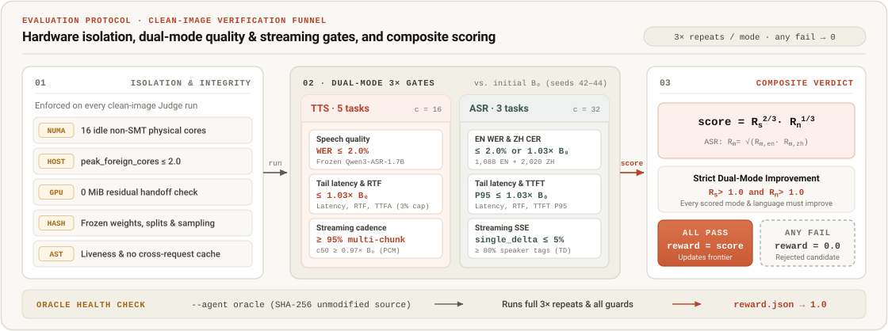

# Evaluation Protocol & Gates

[Overview](../README.md) · [How it works](how-it-works.md) · **Evaluation** · [Running guide](running.md) · [Upstream results](upstream-results.md) · [24h results](../results/README.md)

<p align="center">
  <picture>
    <source media="(prefers-color-scheme: dark)" srcset="../assets/evaluation-gates-dark.svg">
    <source media="(prefers-color-scheme: light)" srcset="../assets/evaluation-gates.svg">
    
  </picture>
</p>

The optimization objective is **sustained serving throughput** under realistic concurrency, guarded by speech intelligibility, tail-latency, streaming-continuity, hardware-isolation, and code-integrity checks. **Any guard violation rejects the submission (`score = 0`).**

<a id="scoring-formula"></a>

## 1. Scoring Formula

Every task in the suite evaluates **both streaming and non-streaming serving** across **3 scored repetitions per mode** (after untimed warmup requests, using fixed repetition seeds `42, 43, 44`). Let **Rₛ** and **Rₙ** denote the candidate's mean throughput divided by the run's initial 3-repetition baseline **B₀** in streaming and non-streaming modes:

```math
\mathrm{score} = R_s^{2/3} \, R_n^{1/3}
```

- **Bilingual ASR tasks:** Each mode's ratio is the geometric mean across English and Mandarin workloads:

```math
R_m = \sqrt{\frac{Q_{m,\mathrm{en}}(C)}{Q_{m,\mathrm{en}}(B_0)} \cdot \frac{Q_{m,\mathrm{zh}}(C)}{Q_{m,\mathrm{zh}}(B_0)}}, \quad m \in \{\mathrm{stream}, \mathrm{nonstream}\}
```

- **Strict dual-mode improvement:** Modified candidates must achieve **`R_s > 1.0` and `R_n > 1.0`** simultaneously (and improve every scored language/mode pair), preventing a speedup in one path from masking a regression in the other.
- **Oracle verification (`reward = 1.0`):** When SHA-256 checks confirm unmodified baseline source (`--agent oracle`), the Judge still executes all 3 repetitions per mode and enforces quality, streaming, and contention gates, writing `reward = 1.0` to `/logs/verifier/reward.json` if healthy.

<a id="per-task-reference-b0"></a>

## 2. Per-Task Reference B₀ & Gate Specification

Reference **B₀** throughputs below are the 3-repetition means baked into `tests/baseline.json`, measured on one **NVIDIA H100 80GB HBM3** GPU (`NS` = non-streaming, `S` = streaming):

- **Shared TTS gates (all 5 tasks · `1,088 EN` SeedTTS · `c = 16`):** Corpus `WER ≤ 2.0%` (transcribed independently by a frozen `Qwen/Qwen3-ASR-1.7B` judge); Latency, RTF, and TTFA `≤ 1.03× B₀` (audio throughput `≥ 0.97× B₀`); streaming PCM `chunk_count ≥ 2` on `≥ 95%` of requests; chunk continuity `c50 ≥ 0.97× B₀`.
- **Shared ASR gates (all 3 tasks · `1,088 EN + 2,020 ZH` SeedTTS · `c = 32`):** Latency, RTF, and TTFT P95 `≤ 1.03× B₀`; SSE `single_delta_fraction ≤ 5%`; per-task WER/CER and diarization guards listed below.

| Task package | Track | Reference B₀ (`req/s`, NS · S) | Task-Specific Quality & Output Gates |
| :--- | :---: | :--- | :--- |
| [`cosyvoice3-dual-mode`](../tasks/cosyvoice3-dual-mode/) | TTS | `9.06` NS · `7.52` S | Shared TTS gates (`WER ≤ 2.0%`) |
| [`moss-tts-v1.5-dual-mode`](../tasks/moss-tts-v1.5-dual-mode/) | TTS | `7.86` NS · `6.56` S | Shared TTS gates (`WER ≤ 2.0%`) |
| [`fish-s2-pro-dual-mode`](../tasks/fish-s2-pro-dual-mode/) | TTS | `1.25` NS · `1.24` S | Shared TTS gates (`WER ≤ 2.0%`) |
| [`qwen3-tts-0.6b-dual-mode`](../tasks/qwen3-tts-0.6b-dual-mode/) | TTS | `17.58` NS · `19.38` S | Shared TTS gates (`WER ≤ 2.0%`) |
| [`qwen3-tts-1.7b-dual-mode`](../tasks/qwen3-tts-1.7b-dual-mode/) | TTS | `18.79` NS · `19.97` S | Shared TTS gates (`WER ≤ 2.0%`) |
| [`qwen3-asr-1.7b-dual-mode`](../tasks/qwen3-asr-1.7b-dual-mode/) | ASR | EN `168.92` / `160.60`<br>ZH `179.78` / `172.06` | Shared ASR gates + `EN WER ≤ 2.0%` & `ZH CER ≤ 2.0%` |
| [`whisper-large-v3-dual-mode`](../tasks/whisper-large-v3-dual-mode/) | ASR | EN `53.21` / `52.43`<br>ZH `48.62` / `48.57` | Shared ASR gates + `EN WER` & `ZH CER ≤ 1.03× B₀` |
| [`moss-transcribe-diarize-dual-mode`](../tasks/moss-transcribe-diarize-dual-mode/) | ASR | EN `106.81` / `102.15`<br>ZH `109.60` / `105.50` | Shared ASR gates + `EN WER` & `ZH CER ≤ 1.03× B₀` + `≥ 80%` speaker tags |

> [!NOTE]
> **Why streaming gates check both chunk count and cadence:**
> - **TTS (`*_stream`):** Requiring `chunk_count ≥ 2` on `≥ 95%` of requests together with `c50 ≥ 0.97× B₀` prevents buffered whole-utterance synthesis disguised as streaming.
> - **ASR (`stream/en`, `stream/zh`):** Requiring `single_delta_fraction ≤ 5%` alongside `TTFT P95 ≤ 1.03× B₀` verifies that SSE endpoints stream incremental text deltas rather than withholding the full transcript until generation completes.

<a id="system-isolation"></a>

## 3. System Isolation & Anti-Cheat Guards

To ensure speedups reflect genuine runtime improvements rather than measurement artifacts or reward hacking, every Judge run enforces five system-level guards:

1. **NUMA-local physical CPU pinning:** Automatically selects and binds **16 distinct non-SMT physical cores** on the target GPU's NUMA node via `/sys/bus/pci/devices` and `/proc/stat`.
2. **Host contention ceiling:** Samples host-wide CPU activity throughout benchmark repetitions and invalidates runs where external processes consume `peak_foreign_cores > 2.0`.
3. **Frozen weights, precision & sampling:** Model checkpoints, tokenizers, SeedTTS audio/text splits, repetition seeds (`42, 43, 44`), and `sglang_omni/sampling/` semantics are verified against SHA-256 manifests and protected paths.
4. **AST & runtime call-site liveness:** Static AST inspection and runtime provenance checks reject request caching across utterances, stubbed model layers, skipped decoding steps, or bypassed HTTP/SSE handlers.
5. **Clean GPU handoff (`0 MiB`):** Before launching the Judge server, the evaluator verifies that no lingering Work-container processes hold memory or compute contexts on the assigned GPU.
