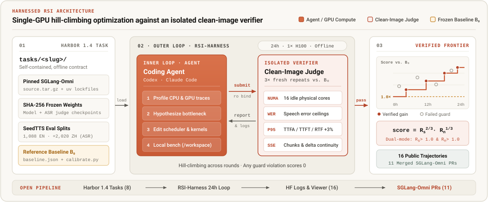

# How it works

[Back to the overview](../README.md) · [Running guide](running.md) · [Evaluation](evaluation.md)

<p align="center">
  
</p>

[RSI-Harness](https://github.com/OpenRSI-Foundation/OpenRSI-Index/tree/main/RSI-Harness) orchestrates the outer loop: the coding agent iterates inside an offline container (`/workspace/sglang-omni`) with 1 GPU and submits candidates whenever ready; each candidate is mounted read-only into a fresh Judge container that benchmarks serving throughput from scratch against the fixed reference baseline B₀ and returns structured telemetry.

Each standalone package under [`tasks/`](../tasks/) follows the Harbor 1.4 layout:

```text
tasks/<task-slug>/
├── task.toml           # Harbor 1.4 resources, 24h budget, clean-image Judge config
├── instruction.md      # Self-contained agent prompt, allowed scope & evaluation contract
├── README.md           # Reference B0 table, logged baselines & GPU recalibration guide
├── environment/        # Pinned Dockerfile, lockfiles & trimmed SGLang-Omni source.tar.gz
├── solution/solve.sh   # Restores pristine baseline source (--agent oracle -> reward 1.0)
└── tests/              # Clean-image evaluator, baseline.json, calibrate.py & gates
```
