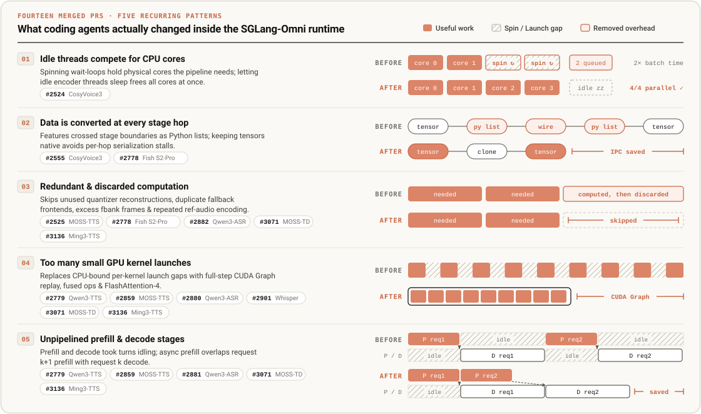

# From benchmark to upstream

[Back to the overview](../README.md) · [Running guide](running.md) · [Evaluation](evaluation.md)

The same harnessed loop was used to land real optimizations in [`sgl-project/sglang-omni`](https://github.com/sgl-project/sglang-omni). Agents ran the profiling and optimization experiments; people defined the problems and reviewed the pull requests. Across 14 merged PRs, agent-found changes fall into **five recurring systems patterns**:

  

Throughput gains on **H100** (non-streaming / streaming), measured on `sglang-omni` `main` before the first and after the last OpenRSI PR:

| Model | Merged PRs | Non-streaming | Streaming |
| :--- | :--- | ---: | ---: |
| CosyVoice3 | [#2524](https://github.com/sgl-project/sglang-omni/pull/2524) [#2555](https://github.com/sgl-project/sglang-omni/pull/2555) | +44.4% | +46.2% |
| MOSS-TTS | [#2525](https://github.com/sgl-project/sglang-omni/pull/2525) [#2859](https://github.com/sgl-project/sglang-omni/pull/2859) | +48.5% | +76.3% |
| Fish S2-Pro | [#2778](https://github.com/sgl-project/sglang-omni/pull/2778) | +9.6% | +0.3% |
| Qwen3-TTS | [#2779](https://github.com/sgl-project/sglang-omni/pull/2779) | +25.2% | +4.7% |
| Qwen3-ASR | [#2880](https://github.com/sgl-project/sglang-omni/pull/2880) [#2881](https://github.com/sgl-project/sglang-omni/pull/2881) [#2882](https://github.com/sgl-project/sglang-omni/pull/2882) | +14.2% | +5.0% |
| Whisper large-v3 | [#2901](https://github.com/sgl-project/sglang-omni/pull/2901) | +7.6% | +12.2% |
| MOSS-Transcribe-Diarize | [#3071](https://github.com/sgl-project/sglang-omni/pull/3071) | +18.8% | +30.0% |
| Ming3-TTS 0.5B | [#3136](https://github.com/sgl-project/sglang-omni/pull/3136) [#3189](https://github.com/sgl-project/sglang-omni/pull/3189) [#3190](https://github.com/sgl-project/sglang-omni/pull/3190) | **+326.5%** | **+93.9%** |

These upstream numbers come from a separate measurement protocol (`128` requests/round on `sglang-omni` `main`) than the benchmark rewards above, and some commit ranges include concurrent upstream changes (#3189 and #3190 also add people-designed opt-in streaming for Ming3-TTS). See the <a href="https://index.openrsi.foundation/blog/2026/openrsi-sglang-omni/">blog post</a> for H200 numbers and per-PR caveats.
